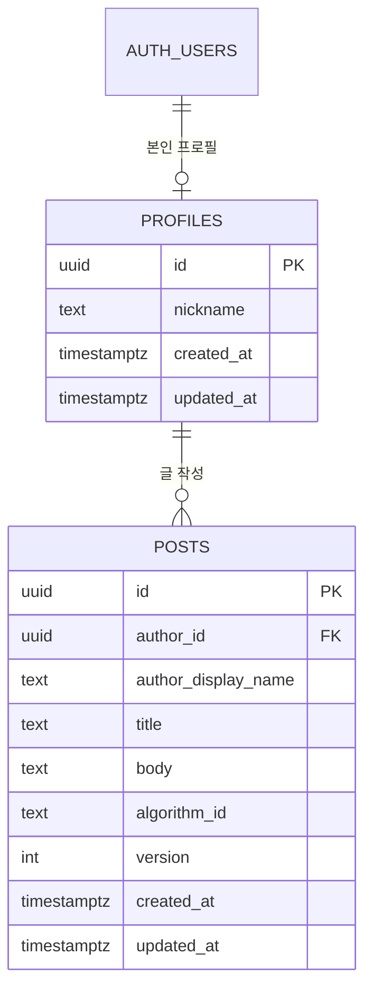
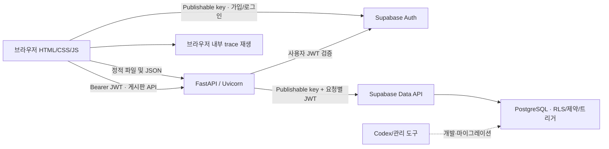

# 알고리즘 실행 시각화 웹사이트 설계

작성일: 2026-10-14. 이 문서는 구현을 위한 제안이며, DB 생성이나 기능 구현이 완료되었다는 뜻은 아니다.

trace 형식·HTTP API·권한·충돌 정책의 최종 계약은 [docs/CONTRACTS.md](docs/CONTRACTS.md), 요구사항별 완료 시나리오와 검증 기록은 [docs/ACCEPTANCE.md](docs/ACCEPTANCE.md)에 둔다. 이 문서와 계약이 다르면 계약 문서가 우선한다.

## 1. 근거와 설계 전제

근거: `frontend/html/idea.html`, `들어가야하는것.txt`, `참고사이트.txt`, 현재 FastAPI 기본 서버 및 Supabase 연결 코드.

- 목적: 알고리즘의 코드, 실행 설명, 자료구조 상태를 동일한 단계에서 보여주어 학습자가 인과관계를 이해하도록 한다.
- 대상: 알고리즘을 처음 배우는 학생. 기본 언어는 한국어이며 PC와 모바일 브라우저를 지원한다.
- 필수: SNS 링크, 지도, 회원가입, 게시판, 파비콘.
- 프런트엔드: 기존 HTML/CSS/JavaScript, 이미지 및 오디오 폴더 구조 유지.
- 백엔드: Python FastAPI + Uvicorn. 인증과 데이터 저장은 Supabase Auth/PostgreSQL.
- 학습 기능은 로그인 없이 사용한다. 로그인은 글 작성과 본인 정보 수정에 필요하다.
- MVP 입력은 준비된 예제만 선택한다. 사용자 코드 실행, 입력 편집, 진도 저장은 후속 범위다.
- 언어는 한 번에 하나만 표시하고 전환 시 같은 의미 단계를 유지한다. 동시 비교는 현재 요구사항에 포함하지 않는다.
- 차별점은 알고리즘과 각 실행 단계에 대한 이해하기 쉬운 한국어 설명이다. 언어별 대응은 학습 기능이며 경쟁 서비스에 없는 기능이라고 주장하지 않는다.
- 모든 시각화 페이지에 '준비된 예제의 실행 기록을 재생합니다. 입력한 코드를 실제로 실행하는 기능은 아닙니다.'라는 안내를 제공한다.
- SNS 링크는 기존 사용자 GitHub 프로필 `https://github.com/2k-c-a`만 사용한다. 소셜 로그인은 요구하지 않는다.
- 지도 장소는 장안대학교로 확정한다. 개인 위치를 수집하지 않으며 학교 이름, 지도, 외부 지도 링크를 제공한다.
- 공개 배포는 하지 않는다. GitHub에 소스 코드를 올리고, 로컬 FastAPI 서버와 Supabase로 실행·시연한다. GitHub Pages와 외부 Python 호스팅은 범위에서 제외한다.
- 수업 제출 일정, 모바일 수업의 앱 패키징 요구 여부는 아직 확인되지 않았다.

## 2. 잘못된 가정과 누락

| 기존 가정 또는 누락 | 문제 | 설계 결정 |
|---|---|---|
| 회원가입은 범위에서 제외 | 필수 목록과 충돌 | 회원가입·로그인·복구는 포함, 진도 저장은 제외 |
| 한 줄과 상태가 항상 1:1 | 언어마다 같은 연산의 줄 수가 다르며 조건문은 상태를 바꾸지 않을 수 있음 | 공통 의미 이벤트와 언어별 실행 줄 목록을 대응. 같은 eventId는 항상 같은 줄을 가리키며, 줄의 의미 적합성은 수동 검토 |
| BFS 8~10줄을 한 단계로 처리 | 방문 기록과 큐 삽입의 중간 상태가 사라짐 | 조건 검사, 방문 기록, 큐 삽입을 별도 이벤트로 구분 |
| 노란 줄은 지금 실행 중인 줄 | 실행 전/후 의미가 불명확 | '방금 실행한 연산'의 코드와 실행 후 상태를 표시 |
| 예제 코드를 보여주면 실제 실행 | 미리 기록한 trace는 인터프리터가 아님 | '준비된 예제 실행 기록'임을 화면에 명시 |
| C/Python/JS 상태를 모두 같은 것으로 표현 | 메모리·컨테이너·정수 동작 차이가 생략됨 | 알고리즘 수준 논리 상태만 공통화하고 언어별 구현 설명 추가 |
| BFS visited가 곧 방문 완료 | 큐에 들어간 발견 노드와 처리 완료 노드는 다름 | discovered, processed, current를 구분 |
| 스택 DFS와 재귀 DFS는 같은 코드 대응 가능 | 호출/복귀 및 순서가 달라질 수 있음 | MVP DFS는 재귀 호출 프레임 스택으로 통일 |
| 미리 만든 trace로 임의 입력 지원 | 입력이 바뀌면 기록도 달라져야 함 | MVP는 검증한 고정 예제만 제공 |
| CLI의 Supabase 연결로 앱도 연결됨 | 개발 도구 설정과 런타임 설정은 별개 | 앱 환경변수와 인증 흐름 별도 구성 |
| Secret key가 있으면 RLS가 사용자 권한을 보호 | Secret key는 RLS를 우회 | 일반 데이터 요청은 Publishable key + 사용자 JWT 사용 |
| 기존 lru_cache Supabase 클라이언트를 로그인에도 재사용 | 가변 세션을 사용자들이 공유할 위험 | 관리자 클라이언트와 요청별 사용자 클라이언트 분리 |
| 프로필 생성을 upsert로 처리 | 재호출이나 다른 탭의 요청이 기존 닉네임을 덮어쓸 수 있음 | 생성은 insert-if-absent, 닉네임 변경은 PATCH만 담당 |
| 프로필이 없으면 `/api/me`가 실패 | 가입 직후 프로필 생성 전 사용자가 오류로 오인하고 프로필을 보완할 수 없음 | `/api/me`는 200 + `nickname: null`, 글 작성만 `profile_required`로 거부 |
| 읽기 API가 선택 인증 | 목록·상세에 사용자별 데이터가 없는데 인증 경로가 생겨 토큰 오류 처리가 복잡해짐 | 읽기 API는 인증 없음, 상세의 `author_id`로 화면이 소유자 버튼을 결정(권한은 서버·DB가 검사) |
| Supabase가 Python 서버도 호스팅 | Supabase는 여기서 인증·DB 담당 | FastAPI 호스팅은 별도로 선택 |
| 경쟁 사이트에 해당 기능이 없다 | 조사만으로 기능 부재나 독창성을 단정할 수 없음 | 차별점은 한국어 설명으로 확정 |
| 지도와 SNS 링크의 목적 미정 | 기존에는 장소와 링크가 확정되지 않았음 | 장안대학교 지도와 사용자 GitHub 프로필만 사용하도록 확정 |

VisuAlgo는 실제 학습 사이트 `https://visualgo.net/en/dfsbfs`를 기준으로 다시 비교한다. 이 사이트는 의사코드 표시를 제공하므로 '코드 연계가 전혀 없다'고 단정하지 않는다. `참고사이트.txt`의 .org 주소가 의도한 대상인지 확인이 필요하다. Algorithm Visualizer의 라이브 사이트는 이번 확인에서 열리지 않아 공식 저장소를 참고했다. 언어 동시 비교 기능의 부재 여부는 확정하지 않았다.

## 3. MVP와 완료 기준

개발 중 첫 검증 단위는 BFS + Python 한 가지다. 수업 제출용 MVP는 네 알고리즘, 일곱 언어와 모든 수업 필수 항목을 포함하는 것을 목표로 한다. 일정이 부족하면 지원 범위를 줄이는 합의가 필요하며, 임의로 필수 항목을 제외하지 않는다.

| 영역 | 제출용 MVP | 후속 확장 |
|---|---|---|
| 알고리즘 | BFS, 재귀 DFS, 이분 탐색, 버블 정렬 | 추가 알고리즘 |
| 언어 | Python → C++ → Java → Kotlin → Rust → C → JavaScript의 검증된 예제; 단일 언어 전환 (현재 Python·C++·Java·Kotlin·Rust·C·JavaScript 구현) | 추가 언어 |
| 입력 | 알고리즘별 기본 예제 + 주요 경계 예제 | 사용자 그래프·배열 입력 |
| 재생 | 다음, 이전, 처음, 재생/일시정지, 속도, 단계 이동 | 실행 비교, 퀴즈 |
| 설명 | 단계 설명, 상태 범례, 시간·공간 복잡도의 적용 조건 | 언어 세부 동작 설명 강화 |
| 계정 | 이메일 가입·확인, 로그인, 로그아웃, 비밀번호 복구 | 소셜 로그인, 진도 저장 |
| 게시판 | 질문 목록·상세·작성·본인 수정·삭제 | 댓글, 첨부, 검색, 신고·관리 UI |
| 필수 요소 | 사용자 GitHub 프로필, 장안대학교 지도, 파비콘 | 필요 시 재설계 |
| 제출·공유 | GitHub 소스, 로컬 실행 README, .env.example, SQL migration | 필요 시 별도 배포 설계 |

완료 기준:

1. 4개 알고리즘 × 7개 목표 언어의 모든 예제가 단계와 코드 매핑 검증을 통과한다.
2. 어느 단계든 이전/다음/슬라이더로 이동하면 동일한 상태가 복원된다.
3. 언어 변경은 현재 의미 단계와 입력을 유지하고, 알고리즘·예제 변경은 처음부터 시작한다.
4. BFS의 발견/처리 순서, DFS 프레임, 이분 탐색 경계, 정렬 교환 결과를 예상 결과와 비교한다.
5. 360px 화면에서 문서 전체 가로 넘침이 없고, 코드 영역만 필요한 경우 가로 스크롤한다. 모바일에서는 코드와 시각화를 같은 페이지에서 위아래로 배치하고 스크롤로 확인할 수 있으며, 단계 조작 버튼에 계속 접근할 수 있어야 한다. 360×800 한 화면에 코드와 그래프 전체가 동시에 들어오는 것은 필수 조건이 아니다.
6. 색 외에 텍스트·모양으로 상태를 구분하고 모든 버튼을 키보드로 조작할 수 있다.
7. 회원 A가 회원 B의 글을 API 및 직접 데이터 접근으로 수정·삭제할 수 없다.
8. 로그인 실패·이메일 미확인·DB 장애·중복 클릭에 사용자 안내가 나온다.
9. SNS·지도·파비콘이 실제로 동작한다. 지도 로딩 실패 시 외부 지도 링크가 제공된다.
10. GitHub 소스만 받아 가상환경·환경변수·DB 설정 후 로컬 실행할 수 있고, 테스트 계정으로 가입·로그인·복구와 권한 검증을 재현할 수 있다.

공개 서비스 운영용 신고·관리 UI, 운영 연락처 및 회원 탈퇴 화면은 이번 MVP에 포함하지 않는다. 실습은 별도 테스트 계정과 예제 게시글로 수행하고, 테스트 데이터 정리 절차를 README에 기록한다. 실제 Supabase 데이터에 대한 인증·권한 검사는 유지한다.

## 4. 사용자 플로우

### 비회원 학습

홈 → 알고리즘 선택 → 언어·예제 선택 → 초기 상태 확인 → 다음/이전/재생 → 실행 줄·설명·상태 확인 → 완료 결과 → 다른 예제.

- 최초 진입은 BFS/Python/기본 예제를 제안하며 시작 전 상태(step 0)를 보여준다.
- URL의 `algorithm`, `language`, `example`은 검증된 식별자만 허용한다. 잘못된 값은 기본값과 안내로 처리한다.
- 비회원도 게시판 목록·상세와 소개·지도를 볼 수 있다.

### 회원가입과 로그인

이용자는 사이트에서 이메일 주소·비밀번호·닉네임으로 가입한다. Supabase 서비스 계정은 이용자 가입 조건이 아니다. Supabase 프로젝트는 개발자/운영자가 준비하며, Supabase Auth는 이메일 인증을 처리하는 내부 인프라다.

가입 폼 → 이메일·비밀번호·닉네임 검증 → Supabase Auth 가입 → 이메일 확인 대기 안내 → 확인 링크 → 인증 결과 확인 → 로그인 → 게시판 작성 가능.

- 이메일 확인 전 세션이 없을 수 있으므로 가입 성공을 로그인 성공으로 처리하지 않는다.
- 로그인 복귀 경로는 같은 사이트의 허용된 상대경로만 사용한다.
- 비밀번호 복구: 이메일 입력 → 계정 존재 여부를 드러내지 않는 안내 → 복구 링크 → 새 비밀번호 설정.
- 로그인 후 프로필이 없으면 본인 프로필 생성 또는 복구를 수행한다. 관리자 Secret key로 모든 사용자 프로필을 노출하지 않는다.

### 게시판

목록 → 글 상세 → 비회원은 로그인 안내 / 회원은 작성 → 제출 → 상세 또는 목록.

- 수정·삭제는 본인만 보이며 서버와 DB에서도 검증한다.
- 로그인 만료 시 작성 내용을 메모리에 유지하고 재로그인을 안내한다. 비밀번호·토큰은 임시 초안에 저장하지 않는다.
- 삭제는 확인 후 수행한다. 동시 수정 충돌은 덮어쓰지 않고 재조회·재편집을 안내한다.

## 5. 기능 명세

| ID | 기능 | 입력과 처리 | 결과/오류 조건 |
|---|---|---|---|
| VIS-01 | 알고리즘 선택 | 허용 ID 선택, 재생 중단, 예제·trace 교체 | step 0; 기존 비동기 응답 무시 |
| VIS-02 | 언어 선택 | 언어별 코드·line map 교체 | 동일 step 유지, 언어 차이 설명 |
| VIS-03 | 다음·이전 | stepIndex 범위 내 ±1 | 끝/처음 버튼 비활성 |
| VIS-04 | 초기화 | timer 취소, step=0 | 초기 스냅샷 표시 |
| VIS-05 | 자동 재생 | 0.5×/1×/2×, 단일 timer | 마지막 단계에서 정지, 탭 숨김 시 일시정지 |
| VIS-06 | 단계 이동 | 정수 인덱스 선택, 재생 중단 | 해당 스냅샷으로 직접 렌더 |
| VIS-07 | 그래프 | 방향 간선, discovered/processed/current, queue 또는 frames | 범례·텍스트 상태 병행 |
| VIS-08 | 이분 탐색 | 정렬 배열, target, left/right/mid | 찾음 인덱스 또는 -1; 중복은 임의의 일치 인덱스 |
| VIS-09 | 버블 정렬 | 배열·비교 인덱스·swap·정렬 완료 범위 | 오름차순, 동일 값은 교환하지 않음 |
| AUTH-01 | 가입 | 이메일, 비밀번호, 닉네임 | 확인 대기·입력 오류·rate limit |
| AUTH-02 | 로그인·갱신 | Supabase JS Auth SDK | 사용자 상태 동기화; 유효하지 않은 토큰은 거부 |
| AUTH-03 | 로그아웃·복구 | SDK signOut / recovery | 세션 제거·복구 결과 안내 |
| BOARD-01 | 목록 | cursor, limit, algorithm 필터 | 최신순, 빈 목록·다음 페이지 |
| BOARD-02 | 작성 | title, body, optional algorithm_id | 201; 작성자 ID는 검증된 사용자에서 결정 |
| BOARD-03 | 수정·삭제 | post ID, version/If-Match | 본인만 가능; 충돌 412 |
| PROFILE-01 | 닉네임 | 2~20자 plain text | 본인만 변경; 게시글 작성 당시 표시명 유지 |
| SITE-01 | SNS·지도·파비콘 | GitHub 프로필, 장안대학교 지도 | 외부 새 창은 noopener, 지도 대체 링크 |
| SITE-02 | 한국어 설명·실행 안내 | 단계 설명, 용어 풀이, 예제 기록 안내 | 실제 코드 실행으로 오인하지 않음 |

페이지 제안: `index.html`, `visualizer.html`, `info.html`, `board.html`, `post.html`, `signup.html`, `login.html`, `reset-password.html`, `auth-callback.html`, `map.html`. 기존 `idea.html`은 기획서로 보존한다. 기존 갤러리·문의는 제출 요구 여부를 확인하고 실습 예제로 남기거나 목적에 맞게 수정한다. 존재하지 않는 `../video/파일명.mp4` 자리표시자 링크는 구현 시 정리한다.

## 6. 실행 기록(trace) 설계

trace는 해당 예제의 소스 코드와 함께 버전 관리하는 정적 JSON(TraceBundle)이다. JSON 파일은 사용자의 폴더 규칙에 맞춰 `frontend/js/data/<algorithmId>/<exampleId>.json`에 둔다. 모든 언어가 같은 논리 이벤트를 공유하지만 실제 실행 시간·메모리 배치가 동일하다는 뜻은 아니다.

bundle은 `schemaVersion`, `contentVersion`(`<algorithmId>-<exampleId>-v<N>`), `algorithmId`, `exampleId`, `input`, `codes`, `steps`로 구성한다. `codes[언어] = {lines: string[], notes: string}`이 코드 텍스트와 언어별 구현 설명을 담고, 각 step의 `lines[언어]`는 그 코드의 1부터 시작하는 줄 번호 배열이다. 코드 텍스트·줄 매핑·trace를 한 파일에 묶으므로 같은 contentVersion으로 함께 바뀐다. 필드 정의, 알고리즘별 `input`·`state`·operation 전이 규칙, 검증 규칙, 실제 JSON 예시는 [docs/CONTRACTS.md](docs/CONTRACTS.md) §3~§4가 최종본이다. 그래프의 노드 위치(`input.layout`)도 거기서 정한다.

- 화면은 방금 실행한 이벤트의 코드와 실행 후 상태를 표시한다. 실행 중임을 가장하지 않는다.
- 조건 검사·반복 검사처럼 상태가 변하지 않는 이벤트도 필요한 곳에 기록한다.
- 공통 연산마다 한 줄 또는 여러 줄을 표시한다. 함수 선언·import 등 학습상 무관한 줄을 생략한다는 안내를 둔다. 이는 모든 실제 언어 명령을 추적하는 디버거가 아니다.
- 매핑 단위는 줄이 아니라 연산이다. 같은 `eventId`(코드의 의미 지점)는 모든 step에서 같은 `operation`과 언어별 같은 `lines`를 가지며, step 1 이후는 모든 언어에서 `lines`가 비어 있지 않다. 검증기는 줄 범위와 이 일관성만 기계적으로 확인하고, 줄이 연산에 맞는지는 사람이 검토해 기록한다.
- BFS enqueue 이전에 discovered에 기록해 중복 삽입을 방지한다. processed는 해당 노드의 이웃 처리가 끝난 뒤 기록한다.
- processed와 같은 학습용 보조 상태는 원본 코드의 실제 변수와 구분해 표시한다. 반복 종료처럼 실제 코드 흐름의 어느 지점에서 확정되는지 설명하며, 원본 코드에 없는 변수를 실행 결과라고 표시하지 않는다.
- DFS는 `frames: [{node, nextNeighborIndex}]`, discovered, processed, current를 저장하고 push/pop을 각각 보여준다.
- 이분 탐색은 left/right를 양끝 포함 구간으로 통일하고 `mid=floor((left+right)/2)`를 사용한다. 종료 시 mid/current를 null로 두고 result=-1 또는 일치 인덱스를 기록한다.
- 버블 정렬은 배열, 비교 인덱스 쌍, 교환 여부, 확정된 뒤쪽 범위를 저장한다. 비교와 교환을 분리한다.
- 스냅샷은 불변 복사한다. 과거 배열을 현재 렌더가 변경하지 않는다.
- 코드는 텍스트로 표시하고 줄별 DOM을 생성한다. 게시글/설명을 innerHTML로 주입하지 않는다.
- 단계 수는 예제당 최대 2,000, 그래프는 노드 12개·간선 24개, 배열은 원소 20개로 제한한다. 숫자는 정수 -999~999. 모두 제안값이며 콘텐츠 검증 시 조정 가능하다.
- 이전/슬라이더 이동에서는 애니메이션보다 정확한 즉시 복원을 우선한다. 애니메이션 콜백이 이전 단계에 덮어쓰지 않도록 재생 세대 ID로 취소한다.

## 7. DB 설계

알고리즘 코드·trace·현재 재생 단계는 MVP에서 DB에 저장하지 않는다. 코드/trace 변경은 Git 리뷰를 거치며 계정 데이터만 Supabase에 저장한다. 비밀번호는 Supabase Auth가 관리한다.

### 테이블

| 테이블 | 필드 | 제약/의미 |
|---|---|---|
| auth.users | id, email, 암호/인증 필드 | Supabase 관리; 직접 비밀번호 테이블을 만들지 않음 |
| public.profiles | id uuid PK/FK auth.users(id), nickname text, created_at timestamptz, updated_at timestamptz | 사용자 삭제 시 CASCADE; nickname 2~20자, 중복 허용 |
| public.posts | id uuid PK, author_id uuid FK profiles(id), author_display_name text, title text, body text, algorithm_id text nullable, version integer, created_at timestamptz, updated_at timestamptz | author FK ON DELETE CASCADE; version 초기 1; 작성자·생성일 불변 |

posts 제약: 공백만 있는 제목/본문 금지, title 1~100자, body 1~10,000자, algorithm_id는 bfs/dfs/binary-search/bubble-sort/null 중 하나. timestamp는 DB에서 UTC로 생성하고 화면에서 사용자 시간대로 표시한다. version은 양수이며 업데이트마다 DB에서 1 증가한다.

작성자의 닉네임은 게시글 작성 시 profiles에서 DB 트리거로 복사한다. 게시글에서 회원 이메일이나 프로필 전체를 조인해 노출하지 않는다. 닉네임 변경은 기존 글의 작성 당시 표시명을 바꾸지 않는 정책이다. 사용자 메타데이터를 관리자 권한으로 사용하지 않는다.

프로필은 인증 완료 후 본인 JWT로 insert-if-absent 방식으로 만든다(예: `INSERT ... ON CONFLICT DO NOTHING` 후 본인 행 조회). 이미 있으면 기존 행을 그대로 두며 닉네임을 덮어쓰지 않는다. 닉네임 변경은 별도 UPDATE(PATCH API)만 담당한다. 실패하면 재시도하고 글 작성을 제한한다. 게시글 작성 API가 클라이언트가 준 author_display_name을 신뢰해서는 안 된다. 프로필이 없으면 트리거는 요청을 거부한다.

### 관계와 인덱스



인덱스: posts(created_at DESC, id DESC), posts(author_id, created_at DESC, id DESC), posts(algorithm_id, created_at DESC, id DESC). UUID 동률 보조 정렬을 통해 페이지 순서를 안정화한다. 댓글·좋아요·조회수 테이블은 MVP에 만들지 않는다.

계정 삭제 시 프로필과 글도 삭제하는 정책을 기본으로 제안한다. 이는 향후 회원 탈퇴 기능 도입 시 사용자 안내와 삭제 처리 절차가 필요하다. 현재 MVP는 테스트 계정을 관리 화면에서 정리한다. 글 보존·작성자 익명화가 필요하면 FK와 삭제 정책을 구현 전에 변경한다. 공개 글은 다른 사용자가 이미 복사했을 수 있다는 한계가 있다.

### RLS와 DB 제약

| 테이블/행위 | anon | authenticated |
|---|---|---|
| profiles SELECT | 금지 | auth.uid() = id인 본인만 |
| profiles INSERT | 금지 | WITH CHECK auth.uid() = id |
| profiles UPDATE | 금지 | USING 및 WITH CHECK auth.uid() = id; nickname만 수정 |
| profiles DELETE | 금지 | 일반 API에서는 금지; 계정 삭제에서 관리 처리 |
| posts SELECT | 허용 | 허용 |
| posts INSERT | 금지 | WITH CHECK auth.uid() = author_id |
| posts UPDATE | 금지 | USING 및 WITH CHECK auth.uid() = author_id |
| posts DELETE | 금지 | USING auth.uid() = author_id |

테이블 권한(grant), 컬럼 권한, RLS, CHECK, 트리거를 함께 설정한다. 소유자 ID·생성일·작성 당시 표시명·version의 임의 변경을 DB에서도 막는다. UPDATE는 title/body/algorithm_id만 허용한다. updated_at/version은 트리거가 처리한다.

동시 수정은 사용자 JWT로 실행하는 SECURITY INVOKER RPC에서 id+author_id+expected_version을 조건으로 원자적으로 UPDATE/DELETE한다. 조회 후 별도 UPDATE만 하는 패턴은 충돌 방지로 충분하지 않다. RPC도 RLS와 권한을 따라야 한다.

클라이언트가 RPC를 거치지 않고 Data API로 직접 PATCH/DELETE하면 version 검사가 빠진다. 그래서 RLS를 우회하지 않는 역할의 직접 UPDATE·DELETE는 트리거(`posts_00_require_rpc`)가 거부하고, 두 RPC만 같은 트랜잭션 안에서 설정값 `app.post_rpc`를 켜서 통과한다(migration 4). RPC는 계속 SECURITY INVOKER이며 SECURITY DEFINER를 쓰지 않는다. 이 방식은 "공개 스키마의 함수만 호출할 수 있고 사용자가 `set_config`를 직접 호출할 수 없다"는 가정에 기대므로, 그 가정을 깨는 노출 함수를 만들지 않는다.

클라이언트가 Supabase Data API를 직접 호출할 수 있음을 전제로 한다. 중요 제약은 FastAPI뿐 아니라 DB에 둔다. API 단독 rate limit은 직접 데이터 호출을 막지 못하므로, 공개 운영 시 쓰기 접근 경로 제한/DB 단위 제한/별도 비공개 스키마 중 하나를 추가 설계한다.

## 8. API 설계

### 인증 책임

MVP는 프런트엔드의 Supabase JS Auth SDK가 가입·이메일 확인·로그인·세션 갱신·로그아웃·복구를 담당한다. FastAPI는 사용자 데이터 요청의 Bearer 토큰을 검증한다. 같은 기능을 Python 인증 API로 중복 구현하지 않는다.

일반 CRUD는 프런트엔드 → FastAPI → Supabase Data API로 처리한다. 인증만 Supabase Auth로 직접 연결하는 혼합 구조다. 모든 요청을 Python으로 통일해야 하는 수업 조건이 있다면 쿠키 기반 인증 API 방식으로 설계를 변경하고 CSRF/갱신/콜백을 별도 구현해야 한다.

| 메서드·경로 | 인증 | 요청 | 성공 응답 |
|---|---|---|---|
| GET / | 없음 | 없음 | /web/html/index.html로 이동 |
| GET /api/health | 없음 | 없음 | 200 {status: ok}; 프로세스 생존만 검사 |
| GET /api/config | 없음 | 없음 | 200 {supabase_url, supabase_publishable_key, app_origin, auth_enabled}; Secret key 제외, 미설정이면 auth_enabled:false와 null |
| GET /api/me | 필수 | Bearer JWT | 200 {id, email, nickname}; 본인 이메일만, 프로필이 없으면 nickname:null |
| POST /api/me/profile | 필수 | {nickname} | 201 최초 생성 / 200 이미 있으면 기존 프로필 그대로(닉네임 덮어쓰기 없음) |
| PATCH /api/me/profile | 필수 | {nickname} | 200 본인 프로필; 프로필이 없으면 404 |
| GET /api/posts | 없음 | limit=20, cursor, algorithm | 200 {items, next_cursor}; limit 최대 50 |
| GET /api/posts/{id} | 없음 | UUID | 200 글 상세 + ETag |
| POST /api/posts | 필수 | {title, body, algorithm_id} | 201 글 상세 + Location + ETag; 프로필이 없으면 403 |
| PATCH /api/posts/{id} | 필수 | 수정 필드 + If-Match | 200 갱신 글 + 새 ETag |
| DELETE /api/posts/{id} | 필수 | If-Match | 204 본문 없음 |

ETag는 `"post-<uuid>-v<version>"` 형식이다. PATCH는 필드 누락(변경 없음)과 null(title/body는 422, algorithm_id는 필터 연결 제거)을 구분하며 수정 필드가 없으면 422다. 요청·응답 필드, 오류 코드, 검사 순서는 [docs/CONTRACTS.md](docs/CONTRACTS.md) §6~§8이 최종본이다.

별도 알고리즘 API는 MVP에서 필요 없다. 예제 JSON을 정적 파일로 제공하며 프런트엔드가 한 번 로딩하고 버튼 클릭은 로컬 상태만 바꾼다.

목록 응답은 본문 전문을 제외하고 id/title/작성 당시 표시명/algorithm_id/created_at/version을 제공한다. cursor에는 마지막 created_at+id+필터를 담고 길이·형식·타입을 검증한다. cursor는 비밀이나 권한 수단이 아니다.

인증 헤더 예: `Authorization: Bearer <access_token>`. 토큰 검증은 초기에는 Supabase Auth의 get_user(jwt)로 수행하고 실패 시 접근을 거부한다. 토큰을 decode만 해서 신뢰하지 않는다. 후속 최적화에서 검증된 JWKS 사용 시 서명·issuer·audience·exp를 함께 검사한다.

오류 형식은 {error: {code, message, request_id, fields?}}로 통일하고 FastAPI validation 오류도 예외 핸들러로 변환한다. 내부 DB 오류·키·토큰·SQL은 응답에 포함하지 않는다.

| 상태 | 상황 |
|---|---|
| 400 | 잘못된 cursor 또는 필터 조합 |
| 401 | 로그인 필요, 만료되거나 잘못된 JWT |
| 403 | 본인 글이 아니거나(`forbidden`), 프로필이 없어 글을 쓸 수 없음(`profile_required`) |
| 404 | 존재하지 않거나 이미 삭제된 글, 수정할 프로필 없음 |
| 412 | If-Match의 글 ID 또는 version이 요청 대상 글과 불일치 |
| 422 | 타입·길이·UUID·허용 ID 검증 실패, 알 수 없는 필드, 형식이 잘못된 If-Match, 수정 필드 없는 PATCH |
| 428 | 수정/삭제에 If-Match 누락 |
| 429 | 요청 제한; Retry-After 안내 |
| 500 | 예상하지 못한 서버 오류 |
| 503 | Supabase 연결 장애·인증 설정 없음; 토큰 유효 여부를 판정할 수 없는 경우도 접근 허용하지 않음 |

수정·삭제에서 오류가 겹치면 경로 UUID 형식(422) → 인증(401/503) → If-Match 없음(428) → 입력·If-Match 형식(422) → 존재·소유권·조건(404 → 403 → 412) 순서로 처리한다. 다른 요청의 세부 순서와 `error.code` 목록은 CONTRACTS.md §8.2, §8.5에 있다. 동시 수정이 충돌(412)하면 서버는 덮어쓰지 않고, 화면은 글을 다시 조회하되 작성 중이던 내용을 지우지 않는다.

외부 글쓰기 응답을 받지 못한 경우 자동 재전송하지 않는다. 사용자가 목록을 확인한 뒤 재시도하도록 안내한다. UI 제출 잠금은 중복 방지에 도움이 되지만 서버 중복 방지 보장은 아니다. 공개 운영에서 확실한 보장이 필요하면 작성 요청에 Idempotency-Key와 사용자별 고유 DB 기록을 추가한다.

## 9. 아키텍처와 폴더



프런트엔드 재생 상태: algorithmId, languageId, exampleId, stepIndex, playbackStatus, speed, loadGeneration. trace 자체는 불변이며 render는 현재 스냅샷만 받아 그린다.

```text
mobile/web/
├── frontend/
│   ├── html/                  페이지
│   ├── css/                   common.css, visualizer.css 등
│   ├── js/
│   │   ├── data/              예제·코드·trace JSON
│   │   ├── renderers/         graph.js, array.js
│   │   ├── visualizer.js      재생 상태·버튼 제어
│   │   ├── auth.js            Supabase Auth SDK 관리
│   │   ├── api.js             fetch·오류·인증 헤더
│   │   └── board.js           게시판 화면
│   ├── img/
│   └── audio/                 기존 실습 파일 보존
├── backend/
│   ├── app/
│   │   ├── main.py
│   │   ├── dependencies.py    요청별 사용자 검증
│   │   ├── routers/           me.py, posts.py
│   │   ├── schemas/           profile.py, post.py, error.py
│   │   └── services/          사용자 DB 접근·관리 클라이언트 분리
│   ├── tests/
│   ├── .venv/                 Git 제외
│   ├── .env                   Git 제외
│   └── requirements.txt
├── supabase/migrations/       SQL 및 RLS 변경 기록
├── docs/                      CONTRACTS.md, ACCEPTANCE.md (00단계에서 작성)
├── .gitignore
└── DESIGN.md
```

위 확장 폴더/파일은 구현 시 추가할 제안이며 `docs/`를 제외하면 현재 모두 존재하는 것은 아니다. main.py의 정적 mount는 frontend만 대상으로 유지한다. web 전체를 mount하면 .env와 백엔드 소스가 노출될 위험이 있다.

개발 환경은 FastAPI가 정적 웹과 API를 같은 origin으로 제공한다. HTML을 file://로 열어 개발하지 않는다. 별도 프런트엔드 서버가 필요하면 CORS에 개발 origin만 명시한다.

환경변수 제안:

```dotenv
SUPABASE_URL=https://project-ref.supabase.co
SUPABASE_PUBLISHABLE_KEY=sb_publishable_...
SUPABASE_SECRET_KEY=sb_secret_...
APP_ORIGIN=http://127.0.0.1:8000
```

Secret key는 관리 작업에 필요할 때만 사용한다. 일반 CRUD는 Publishable key와 검증된 JWT를 쓴다. 환경변수 이름 변경과 클라이언트 분리는 실제 구현에서 적용해야 하며 현재 코드에는 아직 없다. 프런트엔드가 읽는 config에는 URL과 Publishable key만 포함한다. DB 직접 연결이 없으므로 Session Pooler URL은 이 구성에 필요하지 않다.

현재 전역 lru_cache 관리 클라이언트에 sign_in 또는 set_session을 호출하지 않는다. 요청별 JWT 클라이언트는 서로 세션을 공유하지 않는다. 동기 SDK를 사용할 경우 FastAPI 동기 라우트/스레드풀로 처리하거나 async SDK를 사용한다. async 함수에서 동기 네트워크 I/O를 직접 실행하지 않는다.

## 10. 엣지케이스

| 상황 | 기대 동작 |
|---|---|
| 처음/마지막에서 이전/다음 | 인덱스 고정, 버튼 비활성 |
| 재생 연속 클릭·속도 변경 | timer 하나만 유지, 기존 timer 취소 |
| 재생 도중 언어 변경 | 재생 중단, 의미 step 유지 |
| 재생 도중 알고리즘/예제 변경 | 중단·step 0, 오래된 로딩 응답 무시 |
| 브라우저 탭 숨김·화면 회전 | 재생 일시정지, 크기 재계산; 상태 유지 |
| 잘못된 trace·줄 번호 초과 | 재생 막고 콘텐츠 오류 안내; 잘못된 상태를 그리지 않음 |
| 자기 간선·사이클·공유 자식 | discovered 검사로 중복 발견 방지 |
| 방향·연결 끊긴 그래프 | 화살표 표시, 시작점에서 도달 가능한 부분만 탐색 |
| 이웃 순서 | 입력 배열의 순서로 고정; 언어별 결과 순서 일치 |
| DFS 복귀 | frame pop 후 부모 current 복원; 완료 때 current null |
| 빈 배열·한 원소·찾을 값 없음 | 유효 인덱스만 강조, -1을 배열 인덱스로 사용하지 않음 |
| 이분 탐색 중복 값 | 하나의 일치 위치만 반환; 첫 위치 보장 문구 금지 |
| 음수·중복·이미 정렬된 배열 | 값에 맞는 막대/라벨, 안정적 정렬, 종료 조건 일치 |
| 이메일 미확인·가입 이메일 중복 | 로그인 완료로 오인하지 않음; 계정 존재 정보 최소화 |
| 이메일 링크 만료·다른 기기 | 실패 안내·재전송/로그인 선택; 잘못된 성공 화면 금지 |
| 토큰 갱신 실패·네트워크 중단 | 작성 내용 유지, 무한 재시도 금지, 재로그인 안내 |
| 동시에 같은 글 수정/삭제 | version 조건으로 원자적 처리, 충돌 안내 |
| 프로필 생성 실패 | retry 가능한 안내; 사용자 전체 가입을 되돌리지 않음 |
| 제목 공백·너무 긴 글·HTML | 서버/DB 길이 검증, 출력은 plain text |
| 지도 차단·오프라인 | 외부 지도 링크와 주소 텍스트 |
| 모바일 긴 코드 | 코드 영역 가로 스크롤, 설명·조작 버튼 접근 유지 |

## 11. 보안

- 인증: 사용자 JWT를 매 요청 검증하며 사용자가 전달한 author_id는 무시한다. 관리자 역할은 사용자 수정 가능한 metadata/nickname으로 결정하지 않는다.
- RLS: owner 조건을 USING과 WITH CHECK에 적용하며 테이블 GRANT도 검증한다. 비회원/회원 A/회원 B/관리자 테스트로 직접 Data API 우회까지 확인한다.
- 키: Secret key는 RLS를 우회하므로 일반 요청에 사용하지 않는다. .env와 .venv는 Git 제외, 로그/HTML/JS/예외 응답에 키를 넣지 않는다. .gitignore는 이미 커밋된 비밀을 제거하지 못하므로 노출 시 키 교체가 필요하다.
- 세션: MVP는 Supabase JS SDK의 브라우저 세션 저장·갱신을 사용한다. localStorage 기반 토큰은 XSS에 노출될 수 있으므로 CSP, plain-text 렌더, 고정된 SDK 버전, 외부 스크립트 최소화를 적용한다. 높은 보안 요구 시 HttpOnly cookie 기반 BFF로 전환하되 CSRF와 갱신 정책을 추가한다.
- XSS: 게시글·닉네임·코드·단계 설명은 textContent로 표시한다. 사용자 HTML/Markdown 실행은 MVP에서 허용하지 않는다.
- CSRF/CORS: Bearer 방식에서 인증 토큰은 자동 첨부하지 않는다. CORS는 허용 origin만; CORS 자체를 인증으로 보지 않는다. 쿠키 방식 도입 시 별도 CSRF 토큰 및 Origin 검사 필요.
- SQL/필터: 사용자 입력으로 SQL/컬럼/테이블 이름을 조립하지 않는다. 파라미터와 허용 목록을 사용하고 검색 추가 시 wildcard/cursor 검증을 구현한다.
- 사용자 코드: exec/eval/subprocess로 임의 코드를 실행하지 않는다. 후속 코드 실행은 격리 환경, CPU·메모리·시간·출력 제한, 파일/네트워크 접근 제한이 먼저 필요하다.
- 요청 제한: FastAPI 글쓰기·인증 관련 요청을 제한하고 Supabase Auth rate limit을 확인한다. 공개 운영 시 직접 Data API 쓰기 경로까지 포함한 제한이 필요하다.
- 개인정보: 게시판에는 닉네임만 공개하며 이메일·비밀번호·토큰을 공개하지 않는다. 로그에는 토큰을 남기지 않고 request_id로 추적한다. 테스트 계정·게시글만 사용하고 정리 절차를 기록한다.
- 지도: 정확한 학생 개인 위치를 수집하지 않는다. 외부 임베드는 제3자 연결이므로 개인정보 안내 및 대체 링크를 제공한다.
- 로컬 실행: Auth redirect URL을 로컬 접속 주소에 맞추고, 의존성 버전을 고정한다. 공개 배포용 HTTPS·프록시 설정은 현재 구현 범위에서 제외한다.

## 12. 확장성과 운영

| 문제 | MVP 대응 | 규모가 커질 때 |
|---|---|---|
| 단계별 서버 요청 폭증 | 전체 trace를 정적으로 한 번 로드 | CDN·content hash 캐시 |
| 모든 알고리즘을 초기 로딩 | 선택한 알고리즘/예제만 로드 | 모듈 분할·프리페치 |
| 코드·trace 버전 불일치 | 같은 contentVersion 묶음 | 캐시 무효화·스키마 호환 관리 |
| 스냅샷 메모리 증가 | 작은 입력·2,000단계 제한 | checkpoint + delta, lazy rendering |
| 알고리즘마다 화면 복제 | 공통 재생기 + 그래프/배열 renderer | renderer 계약과 콘텐츠 validator |
| 게시판 전체 조회 | 20건 cursor 페이지·인덱스 | 검색 인덱스·요약 캐시 |
| 사용자별 공유 세션 | 요청별 사용자 클라이언트 | stateless worker, 요청 컨텍스트 분리 |
| 매 요청 Auth 네트워크 비용 | 작은 규모에서는 get_user | 서명 검증/JWKS 캐시; 키 회전 대응 |
| 서버 한 프로세스 장애 | 재시작 관리·타임아웃·health | 복수 worker·로드밸런서 |
| process-local rate limit | 수업 개발용 제한 | 공유 저장소 rate limit, 여러 worker 공통 처리 |
| 동기 I/O가 이벤트 루프 차단 | sync 라우트/스레드풀 또는 async SDK | 연결 풀·타임아웃·동시성 제한 |
| DB와 Auth 장애 | 기능별 실패 분리, trace 학습 유지 | 모니터링·백업/복구 시연 |
| DB 스키마 변경 | SQL migration을 Git 관리 | 환경별 적용·후방 호환·롤백 계획 |

Supabase HTTP Data API를 쓰는 현재 설계에는 PostgreSQL Session Pooler를 별도로 연결하지 않는다. 추후 psycopg/SQLAlchemy 직접 연결을 도입할 때 connection pool과 배포 환경의 제약을 다시 설계한다. Uvicorn은 API 실행 서버이며 운영 HTTPS·재시작·백업을 혼자 해결하지 않는다.

제안 성능 목표: 대표 모바일 브라우저에서 버튼 입력 후 렌더 100ms 이내, 기본 예제 압축 전 JSON 200KB 이내. API 응답 목표와 동시 사용자 수는 호스팅 환경 확정 후 부하 측정으로 정한다. 확인하지 않은 Supabase 요금/제한을 고정 수치로 가정하지 않는다.

## 13. 구현 순서와 검증

1. 서버 패키지 설치·기본 실행 확인. /, /api/health, 정적 상대경로 검증.
2. 공통 페이지/메뉴/반응형 레이아웃과 필수 링크 정리.
3. BFS/Python 한 예제로 trace 계약·재생기·graph renderer 구현 및 전체 단계 검증.
4. 같은 BFS의 JS/C 코드 매핑 검증. 이후 DFS·이분 탐색·버블 정렬 추가.
5. 자동 재생·단계 이동·모바일·접근성 검증.
6. Supabase 환경 설정, migration, 프로필·게시글 제약/RLS/트리거/RPC 적용.
7. 회원가입·이메일 확인·로그인·갱신·복구 구현.
8. 게시판 API와 화면 연동, 버전 충돌·직접 데이터 접근 권한 검증.
9. DB/Auth 장애·입력 오류·지도 실패·필수 항목 체크.
10. 로컬 Auth callback과 테스트 이메일 환경을 확인하고 Supabase 테스트 데이터 정리 절차를 준비.
11. README·.env.example·migration·시연 시나리오 정리, 비밀정보 제외 확인 후 GitHub 소스 업로드.

필요한 테스트는 구현을 그대로 따라 쓰는 테스트보다 결과와 권한을 검증한다: trace 최종 결과/불변식, 언어별 유효한 줄 매핑, 이전 복원, A/B 사용자 권한, 동시 수정 충돌, 미인증 거부. 실제 Supabase 연결 테스트는 개발용 프로젝트와 별도 테스트 계정을 사용한다.

## 14. 구현 전 확인할 질문

| 질문 | 현재 제안 기본값 | 바뀌면 영향 |
|---|---|---|
| 제출 기한과 평가 기준은? | 네 알고리즘·일곱 목표 언어·필수 목록 전체 | 개발 순서와 지원 범위 |
| 사용자가 입력을 수정해야 하나? | 고정 예제 선택만 | trace 생성기·입력 검증 필요 |
| 실제 사용자 코드 실행이 필요한가? | 제외 | 실행 격리와 다중 언어 런타임 필요 |
| 인증도 모두 Python 경유해야 하나? | Auth SDK 직접, 게시판은 Python | BFF 인증 및 쿠키 보안 재설계 |
| 회원 탈퇴 후 글을 보존하나? | 계정 삭제 시 함께 삭제 | FK/익명화 정책 변경 |

## 15. GitHub 공유와 로컬 실행 설계

확정: 회원가입 포함, 준비된 예제 실행 기록 안내, 단일 언어 전환, 한국어 설명 중심, GitHub 프로필만 연결, 장안대학교 지도. 공개 배포는 취소하고 GitHub 소스 업로드와 로컬 실행을 목표로 한다. 실제 GitHub 커밋·push는 이번 설계 수정에서 수행하지 않았다.

### 실행과 제출

- backend에서 `python -m uvicorn app.main:app --reload`로 실행하고 `http://127.0.0.1:8000/`으로 접속한다. 프런트엔드와 API를 같은 origin으로 제공한다.
- Supabase Auth와 DB는 온라인 서비스이므로 로컬 서버 실행에도 회원·게시판 기능은 인터넷 연결이 필요하다. 학습 trace는 로딩 후 브라우저에서 재생한다. 오프라인 지원은 별도 요구사항이 아니다.
- GitHub에는 frontend, backend 소스, requirements.txt, .env.example, migration, DESIGN.md, 실행 안내를 올린다. .env, .venv, 비밀 키, 실제 계정/게시글 데이터 덤프는 제외한다.
- README에 Python 버전, 가상환경·패키지 설치, Supabase 환경변수, migration 적용, Auth callback, 테스트 계정 준비, 실행·시연 순서를 기록한다.
- 저장소를 받은 사람이 자신의 Supabase 프로젝트로 재현할 수 있도록 테이블·RLS·트리거·RPC 설정을 SQL migration으로 관리한다. 저장소만 복제하면 원래 Supabase 설정까지 복제되는 것은 아니다.
- GitHub 소스 업로드는 앱 호스팅이 아니다. GitHub Pages, 공개 도메인, 운영 HTTPS 프록시, 외부 Python 서버, 운영 모니터링은 이번 범위에서 제외한다.

### 로컬 회원가입·이메일 확인

- Supabase Auth의 Site URL은 실제 로컬 접속 주소로 설정하고 확인/복구 callback을 정확히 허용한다. 127.0.0.1과 localhost는 서로 다른 origin이므로 한 주소로 통일한다.
- 회원가입·이메일 확인·비밀번호 복구는 테스트 계정으로 검증한다. Supabase 기본 이메일 발송은 수신 대상 제한이 있으므로 허용된 테스트 주소를 쓰거나 필요한 경우 custom SMTP를 설정한다. 공개 배포를 하지 않는다는 이유만으로 이메일 기능이 자동으로 동작하는 것은 아니다.
- 외부 일반 사용자의 이메일 발송을 위한 운영 SMTP는 필수 출시 조건에서 제외한다. 테스트 범위에 맞는 이메일 설정은 여전히 필요하다.
- 콜백 실패·링크 만료·미확인 계정은 한국어 안내로 처리한다. 기본 보안 설계인 이메일 확인·JWT 검증·RLS는 유지한다.

### 공유 전 확인

- .env와 .venv가 Git 추적 대상이 아닌지 확인한다. .gitignore는 이미 커밋된 비밀을 제거하지 않으므로 실제 비밀의 커밋 이력도 확인한다.
- 회원 A/B의 글 수정·삭제 권한, 잘못된 토큰, XSS 문자열, 동시 수정, DB 장애를 검증한다. 로컬 서버여도 Supabase 데이터 접근은 실제 권한으로 처리한다.
- 테스트 데이터만 사용하고 필요 시 Supabase 관리 화면에서 테스트 계정을 정리한다. 자동 계정 삭제 화면은 현재 필수 기능이 아니다.
- 장안대학교 지도와 GitHub 프로필 링크를 확인한다. 지도는 개인 위치를 수집하지 않고 외부 지도 링크를 제공한다.
- 모든 버튼·오류·상태 범례·단계 설명은 한국어로 제공한다. 영어 식별자는 코드에서 유지하고 설명에는 용어 풀이를 덧붙인다.

## 16. 공식 참고 자료

- [Supabase API Keys](https://supabase.com/docs/guides/getting-started/api-keys): Publishable/Secret 구분과 Secret의 RLS 우회.
- [Supabase RLS](https://supabase.com/docs/guides/database/postgres/row-level-security): USING/WITH CHECK 및 행 권한.
- [Supabase Python get_user](https://supabase.com/docs/reference/python/auth-getuser): 서버의 사용자 토큰 검증.
- [FastAPI 배포 개념](https://fastapi.tiangolo.com/deployment/concepts/): HTTPS·재시작·프로세스 운영.
- [VisuAlgo 그래프 탐색](https://visualgo.net/en/dfsbfs): 그래프 시각화와 의사코드 벤치마킹.
- [Python Tutor](https://pythontutor.com/visualize.html): 코드 단계와 런타임 상태 벤치마킹.
- [Algorithm Visualizer 공식 저장소](https://github.com/algorithm-visualizer/algorithm-visualizer): 코드 기반 시각화 구조 참고.
- [Supabase custom SMTP](https://supabase.com/docs/guides/auth/auth-smtp): 공개 서비스의 인증 이메일 발송 설정.
- [Supabase redirect URLs](https://supabase.com/docs/guides/auth/redirect-urls): Site URL과 인증 콜백 허용 목록.
- [FastAPI HTTPS](https://fastapi.tiangolo.com/deployment/https/): 공개 서버의 HTTPS 구성.

외부 문서는 플랫폼 동작을 확인하는 근거이며, MVP 범위·스키마·API·수치 제한은 이 프로젝트에 맞춘 설계 제안이다.


## 언어 확장 정책 (2026-10-16)

표시 순서는 **Python → C++ → Java → Kotlin → Rust → C → JavaScript**이며 일곱 언어 모두 네 알고리즘의 16개 예제에서 선택할 수 있다. 기본 언어는 Python이고 언어 전환 시 현재 단계와 시각화 상태를 유지한다. C++17·Java·Kotlin/JVM·Rust 코드를 제공한다. 각 언어의 한국어 설명과 eventId별 강조 줄을 함께 관리하며 코드 변경 시 contentVersion을 올린다. 실제 실행 검증 여부와 도구 환경의 제한은 docs/ACCEPTANCE.md에 기록한다. 과거 단계별 검증 기록은 당시 이력으로 보존한다.


### 현재 구현과 공유 준비 상태 (2026-10-25)

실제 콘텐츠는 네 알고리즘·16예제·Python/C++/Java/Kotlin/Rust/C/JavaScript 일곱 언어다. 초기 MVP 범위와 과거 기록은 당시 기준으로 보존한다. 이메일 회원 화면·프로필·게시판 API/화면과 CSP가 구현되어 있으며 현재 결과는 README·docs/TEST_RESULTS.md를 따른다. 이용자에게 Supabase 서비스 계정을 요구하지 않는다.

새 환경 설치·로컬 학습 실행을 비밀 파일 없는 복사본에서 재현했다. 실제 Supabase A/B·현재 CSP의 Auth/지도·실기기 검증과 기존 사진·음악 등의 재배포 권리 확인은 남아 있다. 공개 배포는 하지 않으며, GitHub 반영은 별도 요청 때 수행한다. 외부 코드/자산은 docs/THIRD_PARTY.md를 따른다.


### 학습 범위 추가 (2026-10-25)

격자 BFS를 기존 BFS 응용으로 추가하고 유니온 파인드·다익스트라·0/1 배낭 DP·위상 정렬·투 포인터를 별도 유형으로 추가했다. 현재 9개 알고리즘·36개 예제·7개 언어이며, 과거 4개/16개 기록은 당시 결과다. 실제 코드에 맞는 시간·공간복잡도와 전제를 학습 화면에서 제공한다. 상세 계약은 CONTRACTS의 학습 유형 확장 절을 따른다.
