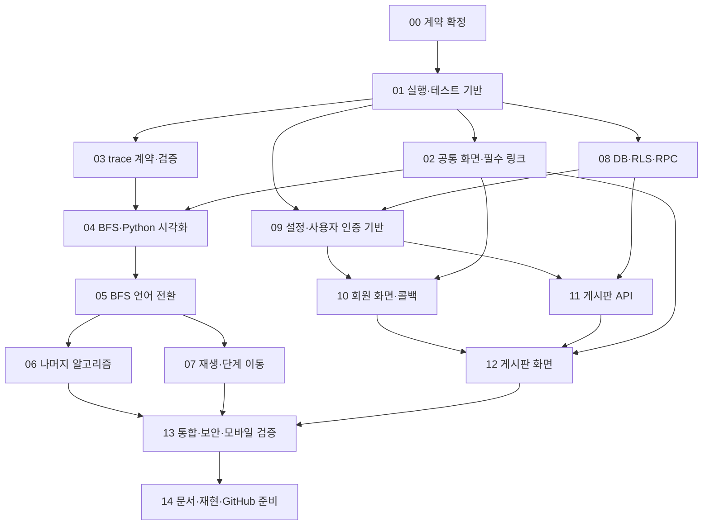

# 의존성 기준 구현 계획

기준일: 2026-10-14. 기준 설계: [DESIGN.md](DESIGN.md).

이 문서는 현재 repository에 설계를 적용할 때의 작업 순서다. 아래 신규 파일과 테스트는 앞으로 만들 대상이며, 이미 구현되거나 통과한 것으로 간주하지 않는다. 이번 작업은 계획 문서 작성만 포함한다.

## 범위와 경로 규칙

- 모든 경로는 `mobile/web/` 기준이다. 프런트엔드 HTML/CSS/JS/이미지는 각각 frontend의 html/css/js/img 안에 둔다. 기존 audio도 보존한다.
- 공개 배포, GitHub Pages, Docker·운영 서버·도메인 작업은 제외한다. 최종 산출물은 GitHub에 공유 가능한 소스와 로컬 실행 안내다.
- 회원가입·게시판은 실제 Supabase Auth/DB를 사용한다. 로컬 실행에도 해당 기능은 인터넷과 프로젝트 설정이 필요하다.
- 알고리즘은 검증한 예제 실행 기록을 재생한다. 단일 언어 전환, 한국어 설명, GitHub 프로필 링크, 장안대학교 지도를 유지한다.
- 알고리즘 입력 편집·사용자 코드 실행·진도 저장·댓글·파일 업로드·탈퇴 화면은 포함하지 않는다.
- 현재 존재하는 파일은 '수정 파일', 이 계획에서 처음 도입하는 파일은 '새 파일'로 구분한다. 앞 단계가 만든 파일을 다음 단계에서 고치면 다음 단계에는 수정 파일로 표시한다.
- README/기획 문서의 내용 변경은 구현 상태와 맞춰 수행한다. 실습용 이미지·음악 파일은 임의로 삭제하지 않는다.
- `.env`의 실제 값은 사람이 로컬에서 설정하며 문서·테스트 fixture·Git에 복사하지 않는다.

## 계획 작성 당시 repository 상태

현재 상태는 README·날짜별 검증 기록을 따른다. 아래 표는 구현 전 기준으로 보존한다.

| 영역 | 현재 상태 | 구현 시 주의 |
|---|---|---|
| frontend | 실습용 6개 HTML, style.css, map/mouse/bgm JS, 이미지·오디오 | 실제 시각화·회원·게시판 화면은 없음 |
| backend | FastAPI main.py, /api/health, /web 정적 파일, Supabase 연결 함수 | CRUD·인증 API는 없음 |
| Supabase 클라이언트 | Secret key 기반 전역 캐시 클라이언트 | 일반 사용자 요청에 재사용하지 않음 |
| 환경 | requirements.txt, .env.example, 로컬 .venv, .gitignore | 의존성은 미고정; 설치·서버 통합 검증 필요 |
| DB | repository에 migration 없음 | 실제 Supabase 상태는 이 문서에서 조회/확정하지 않았음 |
| 문서 | DESIGN.md, backend/README.md | 단계별 완료 후 실행 안내 갱신 |

현재 main.py는 frontend를 `/web` 아래에 제공한다. 실제 HTML 주소는 `/web/html/index.html`이다. 프런트엔드 폴더 이름과 URL mount 이름이 달라도 문제없으며 이 계획에서는 현재 URL을 유지한다.

## 의존성 그래프

| 단계 | 반드시 완료할 선행 단계 | 다른 작업과의 관계 |
|---|---|---|
| 00 | 없음 | 모든 계약의 출발점 |
| 01 | 00 | 파일 제공·테스트 실행 기반 |
| 02 | 01 | 03·08과 독립적으로 진행 가능 |
| 03 | 01 | 02·08과 독립적으로 진행 가능 |
| 04 | 02, 03 | 시각화 첫 완성 단위 |
| 05 | 04 | 언어별 매핑 확정 |
| 06 | 05 | 07과 독립적으로 진행 가능 |
| 07 | 05 | 06과 독립적으로 진행 가능 |
| 08 | 01 | 시각화 완료를 기다릴 필요 없음 |
| 09 | 01, 08 | 실제 프로젝트 환경·테스트 사용자 준비 필요 |
| 10 | 02, 09 | 11과 독립적으로 진행 가능 |
| 11 | 08, 09 | 회원 UI 없이 테스트 JWT로 API 검증 가능 |
| 12 | 02, 10, 11 | 인증과 CRUD를 화면에서 연결 |
| 13 | 06, 07, 12 | 전체 기능을 합치는 검증 관문 |
| 14 | 13 | 새 환경에서 재현·업로드 준비 |

단계 번호는 권장 실행 순서다. 독립 경로라는 표시는 의존성 설명이며 여러 에이전트나 프로세스를 반드시 사용하라는 뜻이 아니다. 특정 Supabase 단계가 외부 설정 때문에 지연되면 독립적인 시각화 단계를 계속 진행할 수 있다.

## 00. 계약과 정책 확정

**선행:** 없음.

**목적:** 코드 작성 전에 trace·API·권한의 해석 차이를 제거한다.

**수정 파일**

- `DESIGN.md`: 프로필 생성, 코드 매핑, 오류·버전 충돌 정책을 최종 계약과 일치시킨다.
- `frontend/html/idea.html`: 회원가입 제외 문구와 '한 줄 1:1' 주장을 확정 요구에 맞게 정정하고 기존 기획 내용을 보존한다.

**새 파일**

- `docs/CONTRACTS.md`: TraceBundle, 상태 타입, 인증/공개 config, HTTP 요청·응답 계약.
- `docs/ACCEPTANCE.md`: 요구사항 ID와 완료 시나리오, 수동 검증 기록 양식.

**인터페이스**

- TraceBundle: schemaVersion, contentVersion, algorithmId, exampleId, input, codes, steps. `codes[language] = {lines: string[], notes: string}`. 코드·매핑·스냅샷을 같은 bundle에 묶는다.
- TraceStep: index, eventId, operation, lines(언어별 1부터 시작하는 줄 배열), state, message. index 0은 initial, lines는 빈 배열이다.
- 언어 목표 순서는 python/cpp/java/kotlin/rust/c/javascript이고 현재 지원 ID는 python/cpp/java/kotlin/rust/c/javascript, 알고리즘 ID는 bfs/dfs/binary-search/bubble-sort로 고정한다.
- step은 방금 실행한 연산의 실행 후 상태다. 학습용 보조 상태는 코드 변수와 구분한다.
- 모든 오류는 `{error:{code,message,request_id,fields?}}`. ETag는 `"post-<uuid>-v<version>"`로 고정한다.
- 게시글 수정·삭제는 If-Match 필수. 누락 428, 버전 불일치 412, 타인 소유 403, 없음 404.
- 프로필 생성 POST는 insert-if-absent이다. 이미 존재하면 현재 프로필을 반환하고 닉네임을 덮어쓰지 않는다. 닉네임 변경은 PATCH만 담당한다.
- 프로필이 없어도 `/api/me`는 200과 nickname:null을 반환한다. 프로필 보완 후 글 작성이 가능하다.

**테스트**

- 수동 계약 리뷰: JSON 예시와 응답 예시가 설계 요구를 모두 표현하는지 확인한다.
- 검증 기준에 구현이 불가능한 '모든 언어의 모든 실제 줄이 1:1' 같은 조건이 남아 있지 않은지 확인한다.

**완료 조건**

- [x] trace 구조·ID·단계 의미·API 상태코드가 하나로 확정되어 있다.
- [x] 회원가입/단일 언어/한국어/지도/GitHub/로컬 실행 요구가 계약에 반영되어 있다.
- [x] 소스 작성 담당자가 별도 추측 없이 다음 단계 fixture를 만들 수 있다.

00단계 문서 검토 완료(2026-10-14). 추가 정책은 CONTRACTS.md를 따른다. 작성 당시 임시 전이 검증 스크립트는 저장소에 없으므로 이번 검토에서 재실행하지 않았고, 실제 validator·fixture·API 검증은 후속 단계에서 수행한다.

## 01. 로컬 실행과 테스트 기반

**선행:** 00.

**수정 파일**

- `backend/app/main.py`: test 가능한 app factory와 기존 app export 유지, frontend만 정적 mount.
- `backend/requirements.txt`: 실제 설치·확인한 런타임 의존성 버전 고정.
- `backend/README.md`: Python 버전, 가상환경·실행 방법, 기본 URL.
- `.gitignore`: 테스트 산출물 제외; 기존 .env/.venv 제외 유지.

**새 파일**

- `backend/requirements-dev.txt`: pytest/httpx 등 API 테스트 의존성.
- `backend/pytest.ini`, `backend/tests/conftest.py`, `backend/tests/test_static.py`.
- `package.json`: type:module과 Node 기본 test runner 스크립트; 프런트엔드 빌드 도구는 도입하지 않음.
- `README.md`: 프로젝트 전체 개요와 로컬 시작 안내 초안.

**인터페이스**

- `create_app(settings=None) -> FastAPI`, 모듈 변수 `app` 제공. Uvicorn의 `app.main:app` 유지.
- `/` → `/web/html/index.html`, `/api/health` → 200 `{status:"ok"}`.
- Supabase 설정이 없어도 정적 웹과 health는 실행 가능해야 한다. 회원·게시판 기능만 설정 상태에 따라 제한한다.
- Python 테스트는 backend에서 `python -m pytest`, JS 테스트는 web에서 `npm test`로 실행한다.

**테스트**

- test_static.py: redirect, health, HTML/CSS/JS/파비콘 응답 확인.
- `/web/backend/.env`, `/web/../backend/.env`, `/web/.env` 등 비밀 경로가 공개되지 않는지 확인한다.
- Uvicorn 실 실행으로 홈페이지와 상대경로를 확인한다. TestClient 검증만으로 실행 완료로 표시하지 않는다.

**완료 조건**

- [x] 서버가 실제 실행되며 기존 웹 자산을 읽는다.
- [x] Python/Node 테스트를 동일한 명령으로 재실행할 수 있다.
- [x] Supabase 미설정 상태에서 기본 학습 사이트 실행을 막지 않는다.

01단계 검토 완료(2026-10-14): 백엔드 44개 테스트 통과(실제 Uvicorn 프로세스 포함), pip check 통과, npm test 정상 종료(테스트 0개). 제한 실행 환경에서 TestClient가 멈춰 제한 밖에서 검증했다. frontend 기능 테스트는 후속 단계에서 추가한다.

## 02. 공통 화면과 필수 링크

**선행:** 01.

**수정 파일**

- `frontend/html/index.html`, `info.html`, `map.html`: 사이트 목적, 메뉴, GitHub 링크, 장안대학교 지도.
- `frontend/html/idea.html`, `gallery.html`, `contact.html`: 메뉴를 통일하고 실습 페이지임을 명확히 표시.
- `frontend/css/style.css`: 공통 디자인·반응형·focus 스타일; 기존 실습 페이지 호환.
- `frontend/js/map.js`: 장안대학교 기본 위치와 입력 접근성·지도 대체 링크 처리.

**새 파일**

- `frontend/js/site.js`: 공통 메뉴·현재 페이지 표시. 인증 의존성은 아직 연결하지 않음.
- `tests/frontend/static-links.test.mjs`: 로컬 href/src 경로 검증.

**인터페이스**

- 메뉴 링크의 주소는 `/web/html/...` 또는 같은 폴더 상대경로로 일관화한다.
- 미래 페이지는 아직 생성하지 않은 단계에서는 일반 링크로 활성화하지 않는다. 실제 페이지 생성 후 메뉴에 연결한다.
- SNS는 `https://github.com/2k-c-a`, 지도는 장안대학교. 외부 창에는 noopener 적용.
- 장안대학교의 이름·위치를 확인하고 지도 실패 시 사용할 외부 지도 링크와 장소 텍스트를 항상 제공한다.

**테스트**

- static-links.test.mjs: 존재하지 않는 로컬 파일 링크 감지. 예제 영상 자리표시자를 실제 정상 파일로 오인하지 않는다.
- 수동: 360px/768px/PC, 키보드 focus, GitHub 링크, 지도 로딩 실패 대체 링크, 파비콘.

**완료 조건**

- [x] 모든 활성 메뉴가 존재하는 페이지로 연결된다.
- [x] 전역 가로 넘침 없이 공통 화면이 동작한다. (구현자의 6페이지·4개 폭 측정 기록을 근거로 판정; 독립 재측정은 미실행)
- [x] GitHub·장안대학교 지도·파비콘을 확인했다. (지도 실제 표시는 2026-10-14 사용자 확인)

02단계 독립 검토(2026-10-14): 구현 완료, 지도 렌더링 검증 대기. npm 33개·pytest 46개 통과. GitHub·파비콘·지도 대체 링크는 확인됐지만 Chrome에서도 iframe이 빈 화면이어서 지도 완료 조건은 미체크로 유지한다. 원인을 내장 브라우저 한계로 확정하지 않는다. 개인 이메일 링크는 사용자의 유지 결정에 따라 그대로 둔다. 03단계는 01단계만 선행하므로 진행 가능하다.

02단계 최종 완료(2026-10-14): 사용자가 지도 정상 표시와 문제없음을 확인했다. 독립 자동 테스트 및 기존 구현자 검증 기록과 함께 모든 02단계 완료 조건을 충족한다. 도구에서 발생한 빈 iframe의 원인은 확정하지 않으며, 사용자 확인을 별도 검증 근거로 기록한다.

## 03. trace 스키마·로더·콘텐츠 검증

**선행:** 01. 02의 화면 완성을 기다릴 필요는 없다.

**수정 파일**

- `docs/CONTRACTS.md`: 실제 JSON과 타입에 맞춰 계약 보완.
- `package.json`: 콘텐츠 검증 스크립트 추가.

**새 파일**

- `frontend/js/trace-contract.js`: JSDoc 타입과 상수.
- `frontend/js/trace-validator.js`: 구조·크기·줄 매핑·상태 불변식 검사.
- `frontend/js/trace-loader.js`: 예제 로딩, AbortSignal 지원.
- `frontend/js/data/catalog.json`: 알고리즘·예제·언어 목록; 존재하는 bundle만 등록.
- `frontend/js/data/bfs/diamond.json`: Python 코드와 초기 BFS 기본 fixture.
- `scripts/validate-traces.mjs`, `tests/frontend/trace-contract.test.mjs`.

**인터페이스**

- `validateBundle(bundle) -> {valid:boolean, errors:string[]}`.
- `loadBundle(algorithmId, exampleId, {signal}) -> Promise<TraceBundle>`.
- catalog는 `{schemaVersion, algorithms:[{id,title,examples:[{id,title,path,languages}]}]}`.
- bundle는 등록된 언어의 코드·매핑을 반드시 포함한다. 03~04에는 Python만 등록하고 05에서 JS/C를 추가한다.
- 2,000단계/노드12/간선24/원소20/정수 범위를 검사한다. 초기 상태도 유효해야 한다.
- 외부 URL이나 임의 파일 경로를 입력에서 받지 않고 catalog의 허용 경로만 읽는다.

**테스트**

- 유효 fixture, 줄 번호 초과, 누락 코드, 불연속 index, 알 수 없는 operation, 입력 크기 초과, 공유된 과거 상태 변형을 검사한다.
- 알고리즘별 상태 필드를 분리하고 배열/노드 참조의 유효성을 검사한다.

**완료 조건**

- [x] 유효한 BFS fixture는 로드되고 잘못된 fixture는 오류 이유와 함께 거부된다.
- [x] 코드·매핑·trace의 contentVersion을 하나로 관리한다.
- [x] `npm run validate:traces`가 현재 등록된 모든 예제를 검증한다.

03단계 최종 완료(2026-10-14): 기존 두 반례를 독립적으로 재실행해 거부를 확인했다. 시작 발견 규칙과 독립 BFS 최종 결과 비교, 전달 catalog의 복사→검증→freeze 및 원본 변경 회귀 테스트를 검토했다. npm 127개·pytest 51개 통과, validate:traces는 BFS/Python 1개·22단계 통과. 나머지 알고리즘의 전이 검증은 06단계까지 의도적으로 미지원이며 AC-01 전체 완료를 뜻하지 않는다.

## 04. BFS + Python의 첫 완성 화면

**선행:** 02, 03.

**수정 파일**

- `frontend/html/index.html` 및 공통 메뉴: 시각화 페이지 연결.
- `frontend/js/data/bfs/diamond.json`: 전체 실행 기록 완성.
- `frontend/js/data/catalog.json`: 사용 가능한 기본 예제 등록.

**새 파일**

- `frontend/html/visualizer.html`, `frontend/css/visualizer.css`.
- `frontend/js/player-state.js`: DOM 없는 단계 상태 전이.
- `frontend/js/visualizer.js`: 로딩·버튼·렌더 연결.
- `frontend/js/renderers/code.js`, `frontend/js/renderers/graph.js`.
- `tests/frontend/player-state.test.mjs`, `tests/frontend/bfs.test.mjs`.

**인터페이스**

- `createPlayerState(bundle, languageId)`, `reducePlayer(state, action)`.
- action: NEXT, PREVIOUS, RESET, SEEK. 반환 상태는 immutable, stepIndex는 0~마지막 범위.
- `renderCode(root, codeLines, activeLines)`, `renderGraph(root, input, snapshot)`는 현재 상태만 그린다.
- graph snapshot: discovered, processed, queue, current, neighbor. 발견/처리 완료와 큐의 앞·뒤를 텍스트로 표시.
- SVG를 코드에서 생성해 DOM에 그린다. 새 시각화용 이미지를 파일로 저장하면 img 폴더를 사용한다.
- 예제 실행 기록 안내, '방금 실행한 연산', 한국어 설명을 항상 제공한다.

**테스트**

- BFS 결과와 예상 큐 변화, 발견 중복 방지, 처리 완료 시점, 방향 간선·공유 자식 D 확인.
- 마지막→이전→다음 결과 동일, 처음 이전/마지막 다음 범위 고정, snapshot 변경 없음.
- 수동: 모든 단계를 코드·설명·그래프와 함께 점검. 조건 검사 단계도 누락 여부 확인.

**완료 조건**

- [x] BFS/Python 한 예제를 처음부터 완료까지 조작할 수 있다.
- [x] 모든 단계의 설명과 실행 후 상태가 정확하다.
- [x] 이전은 실제 스냅샷 복원이며 단계별 서버 호출이 없다.

04단계 최종 완료(2026-10-15): controls.js의 버튼 갱신 후 포커스 이동과 회귀 테스트를 검토했다. npm 204개·pytest 58개 통과, 콘텐츠 1개·22단계 통과. Chrome에서 21단계 RESET 후 0단계의 활성 btn-next에 포커스가 유지되어 기존 지적을 해소했다. 실제 스크린 리더·Safari·모바일 실기기 검증은 후속 통합 검증 대상이며 완료했다고 간주하지 않는다.

## 05. BFS 언어 전환

**선행:** 04.

**수정 파일**

- `frontend/js/data/bfs/diamond.json`, `catalog.json`: JS/C 코드·매핑 추가.
- `frontend/html/visualizer.html`, `frontend/js/visualizer.js`, `player-state.js`: 언어 선택과 SWITCH_LANGUAGE.
- `tests/frontend/player-state.test.mjs`, `trace-contract.test.mjs`: 전환·매핑 검증 추가.

**새 파일**

- `tests/frontend/language-mapping.test.mjs`.

**인터페이스**

- SWITCH_LANGUAGE는 stepIndex/예제/알고리즘을 유지하고 재생을 중단한다.
- 모든 언어는 같은 operation에 해당하는 하나 또는 여러 실행 줄을 표시한다. 실제 실행 줄 수·메모리가 동일하다고 안내하지 않는다.
- Python deque, JS 큐 인덱스, C 큐 배열 등의 차이를 한국어 notes로 설명한다.
- JS 큐 구현의 시간복잡도는 실제 선택한 구현과 맞춘다. shift를 사용하면서 항상 O(1) dequeue라고 설명하지 않는다.

**테스트**

- 처음/중간/마지막 단계에서 세 언어를 전환하고 논리 상태 동일성을 확인한다.
- 모든 매핑의 줄 범위와 해당 연산의 의미를 확인한다. 줄 범위 검사만으로 의미 검증을 대체하지 않는다.
- 세 예제 코드의 최종 결과를 비교한다. C 컴파일러가 없으면 코드 리뷰 상태를 기록하고 실행 검증 완료로 표시하지 않는다.

**완료 조건**

- [x] BFS의 세 언어 전환과 상태 유지가 동작한다.
- [x] Python/JS/C 코드가 trace와 같은 알고리즘·이웃 순서를 표현한다.

05단계 독립 검토 완료(2026-10-15): 언어 상태 전이·select/pre 재사용·코드 스크롤·세 언어 코드/매핑·실행 테스트를 검토했다. npm 264개·pytest 59개 테스트 실행 및 콘텐츠 1개·22단계 검증이 성공했다. Chrome의 4단계에서 C→JavaScript 전환 시 단계·상태 유지, 코드/설명/강조 줄 갱신과 키보드 포커스 유지를 확인했다. 자동 재생 중지는 07단계까지 미실행으로 유지한다.

## 06. DFS·이분 탐색·버블 정렬 확장

**선행:** 05.

**수정 파일**

- `frontend/js/data/catalog.json`, `trace-contract.js`, `trace-validator.js`.
- `frontend/js/visualizer.js`, `renderers/graph.js`, `frontend/css/visualizer.css`.
- `tests/frontend/trace-contract.test.mjs`, `language-mapping.test.mjs`.

**새 파일**

- `frontend/js/renderers/array.js`.
- bundle 파일: bfs/cycle.json, bfs/disconnected.json, dfs/basic.json, dfs/cycle.json, dfs/disconnected.json, binary-search/basic.json, binary-search/empty.json, binary-search/single.json, binary-search/not-found.json, binary-search/duplicates.json, bubble-sort/basic.json, bubble-sort/empty.json, bubble-sort/single.json, bubble-sort/sorted.json, bubble-sort/negative-duplicates.json. 모든 경로의 앞에는 `frontend/js/data/`가 붙는다.
- `tests/frontend/dfs.test.mjs`, `binary-search.test.mjs`, `bubble-sort.test.mjs`.

**인터페이스**

- DFS 상태: frames[{node,nextNeighborIndex}], discovered, processed, current. 재귀 push/pop과 복귀를 표시.
- 이분 탐색 상태: values, target, left, right, mid, result. 양끝 포함; 실패 result=-1; 중복은 임의 일치 인덱스.
- 버블 정렬 상태: values, compareIndices, swapped, sortedFrom. 비교와 교환을 별도 operation으로 제공.
- renderer 선택은 algorithmId별 registry로 처리하고 공통 재생 UI를 복제하지 않는다.
- 모든 등록 예제는 현재 지원 언어(Python/C++/Java/Kotlin/Rust/C/JavaScript)의 코드와 전체 line map을 가진다. 일곱 언어에 같은 콘텐츠 검증 기준을 적용한다.

**테스트**

- DFS 호출 스택 깊이·복귀·사이클 종료·도달 불가능 노드.
- 이분 탐색 구간 축소, 유효 인덱스, 빈 배열/한 원소/없음/중복.
- 정렬 결과의 오름차순·입력 multiset 보존·동일 값 불필요 교환 없음·음수 표시.
- bundle 전체 structural 검증과 예상 최종 결과 검증을 함께 수행한다.

**완료 조건**

- [x] 4개 알고리즘 × 3개 언어와 등록된 경계 예제가 동작한다.
- [x] 알고리즘·예제 변경은 step 0이며 이전 로딩 결과가 새 화면을 덮어쓰지 않는다.
- [x] 공통 재생기를 수정하지 않고 콘텐츠·renderer로 알고리즘을 확장할 수 있다.

06단계 최종 완료(2026-10-15): focus-guard와 가짜 DOM 숨김 모델·회귀 테스트를 검토했다. npm 396개·pytest 67개 실행 및 16개 예제 검증 성공. 최신 코드가 제공되는 Chrome에서 404→Enter 재실패 시 viz-retry 복원→Enter 복구 시 example-select 유지로 기존 지적 해소를 확인했다. 자동 재생과 실기기·스크린 리더·다른 엔진 검증은 후속 단계 대상이다.

## 07. 자동 재생·속도·단계 이동

**선행:** 05. 06과 병행 가능하며 이후 모든 renderer에서 13 단계 통합 검증.

**수정 파일**

- `frontend/html/visualizer.html`, `frontend/css/visualizer.css`.
- `frontend/js/player-state.js`, `visualizer.js`, `tests/frontend/player-state.test.mjs`.

**새 파일**

- `frontend/js/playback.js`, `tests/frontend/playback.test.mjs`.

**인터페이스**

- `createPlayback({advance,getState,scheduler}) -> {play,pause,setSpeed,destroy}`.
- 기본 1×는 단계당 1초, 0.5×는 2초, 2×는 0.5초로 정의한다. scheduler를 주입해 테스트한다.
- 단일 timer 유지. 마지막에서 정지; 언어·알고리즘·예제 변경, SEEK, hidden 탭, 페이지 종료에서 timer 취소.
- loadGeneration/playbackGeneration으로 오래된 fetch·animation callback의 반영을 차단한다.

**테스트**

- 가짜 scheduler로 중복 play, 속도 변경, 끝 자동 정지, pause 후 남은 callback 무효화 검증.
- 수동: 슬라이더·재생 중 선택 변경·탭 숨김·빠른 연속 클릭·화면 회전.

**완료 조건**

- [x] 모든 조작에서 timer가 하나 이하이며 오래된 callback으로 화면이 되돌아가지 않는다.
- [x] 속도와 단계 이동이 코드/설명/자료구조를 같은 시점으로 유지한다.

07단계 독립 검토 완료(2026-10-15): 상태 전이·단일 timer·세대 무효화·재진입/예외 정리·로딩 중단·조작 UI 테스트를 검토했다. npm 451개·pytest 68개 테스트 실행 및 16개 예제 검증 성공. Chrome에서 자동 진행과 언어 전환·키보드 슬라이더 조작의 정지 및 상태/포커스 갱신을 확인했다. 실제 OS/브라우저 탭 숨김·스크린 리더·Safari·실기기 확인은 13단계에 남긴다.

## 08. DB migration·RLS·충돌 제어 RPC

**선행:** 01. Supabase 대상 프로젝트와 관리 권한이 필요하다.

**수정 파일**

- `docs/CONTRACTS.md`: 실제 DB 제약·RPC 인자·결과 확정.

**새 파일**

- `supabase/migrations/202610140001_profiles_posts.sql`: 테이블·인덱스·CHECK·FK.
- `supabase/migrations/202610140002_rls_triggers.sql`: GRANT/RLS/불변 컬럼·표시명·version 트리거.
- `supabase/migrations/202610140003_post_mutations.sql`: 수정·삭제 RPC.
- `supabase/tests/rls.sql`, `supabase/tests/post_mutations.sql`, `supabase/README.md`.
- `supabase/migrations/202610160001_posts_rpc_only.sql`(2026-10-16 코드 리뷰 반영): RPC를 거치지 않은 직접 UPDATE·DELETE 거부. 적용 완료된 migration 1~3은 고치지 않고 새 파일로 추가했다.

**인터페이스**

- profiles(id,nickname,created_at,updated_at), posts(id,author_id,author_display_name,title,body,algorithm_id,version,created_at,updated_at).
- 제목 1~100자/본문 1~10,000자/닉네임 2~20자, 공백 검사와 ID 허용 목록.
- profiles는 본인만 조회·생성·닉네임 수정, posts는 누구나 조회·회원 본인 작성·소유자만 수정/삭제.
- `update_post(p_id,p_expected_version,p_title?,p_body?,p_algorithm_id?,...)`와 `delete_post(p_id,p_expected_version)`는 SECURITY INVOKER로 실행. 누락 필드와 명시 null 구분 방식은 RPC 계약에 명시한다.
- 소유자 확인 후 id+auth.uid()+expected_version 조건으로 원자적 mutation. `ok/not_found/forbidden/version_conflict` 결과를 HTTP 상태로 변환한다.
- 수정 RPC는 동일 버전의 두 요청 중 하나만 성공해야 한다. SELECT→UPDATE의 분리만으로 처리하지 않는다. 행 잠금/원자 조건을 명시한다.
- version·timestamps·작성자·작성 당시 닉네임을 사용자 입력으로 변경할 수 없게 한다. 직접 Data API 접근도 RLS/제약을 따른다.

**테스트**

- SQL 테스트는 권한 role·JWT claim을 명시한 트랜잭션 안에서 수행하고 종료 시 rollback한다. 표준 Auth 회원 생성은 관리 API/테스트 환경에서 처리하며 운영 auth.users를 임의로 조작하지 않는다.
- anon/A/B로 SELECT/INSERT/UPDATE/DELETE, 타인 author_id 삽입, author_id 변경, 닉네임 위조, 길이·version·timestamp 변조를 검사한다.
- 테스트 실행용 관리자 연결 권한으로 성공한 것을 사용자 권한 테스트로 오인하지 않는다. 각 테스트는 실제 역할로 전환한다.
- A의 현재 version 수정은 성공, 같은 이전 version 재수정은 충돌, B의 mutation은 거부. 11에서 동시 네트워크 요청도 확인한다.

**완료 조건**

- [ ] 비어 있는 개발 프로젝트에 migration 순서대로 적용해 DB를 재현할 수 있다.
- [ ] RPC 포함 모든 사용자 쓰기에 소유권 검사가 적용된다.
- [ ] 기존 DB가 있다면 diff를 확인해 충돌을 조정했으며 기존 사용자 데이터를 임의 삭제하지 않았다.

08단계 코드 리뷰 반영(2026-10-16): 작성자가 Data API로 직접 PATCH/DELETE를 보내면 version 검사를 우회할 수 있어 migration 4를 추가하고 DB 테스트(rls 516개 등)를 갱신했다. 실제 Supabase 프로젝트에는 아직 적용하지 않았으므로 아래 체크박스는 그대로 둔다. 자세한 내용은 ACCEPTANCE.md의 "코드 리뷰 반영"을 본다.

08단계 수정 독립 재검토(2026-10-15): 첫 migration의 동일 트랜잭션 내 RLS·권한 회수와 실행기 인자·검사 0개 검증으로 기존 P2 두 건이 해소되었다. 전체 npm 테스트(DB 단계별 검사 포함), pytest 68개, trace 16개 검증이 성공했다. 실제 Supabase 개발 프로젝트 적용 및 기존 DB 확인은 미실행이므로 전체 완료 체크박스는 유지한다.

## 09. 공개 config·사용자 인증·프로필 API

**선행:** 01, 08.

**수정 파일**

- `backend/.env.example`: URL/Publishable key/선택적 관리자 Secret key/APP_ORIGIN 구분.
- `backend/app/services/supabase.py`: 관리용과 요청별 사용자 클라이언트 분리.
- `backend/app/main.py`: router·오류 핸들러 연결; 정적 mount 유지.
- `backend/requirements.txt`, `backend/README.md`: 확정한 인증 의존성·설정 설명.

**새 파일**

- `backend/app/config.py`, `dependencies.py`, `errors.py`.
- `backend/app/routers/config.py`, `me.py`.
- `backend/app/schemas/profile.py`, `error.py`, `backend/app/services/profiles.py`.
- `backend/tests/test_auth.py`, `test_config.py`, `test_profiles.py`.

**인터페이스**

- `GET /api/config` → `{supabase_url,supabase_publishable_key,app_origin,auth_enabled}`. Secret key 반환 금지. 미설정 상태는 auth_enabled:false와 null 값으로 명시.
- `get_current_user(bearer) -> VerifiedUser{id,email}`는 Supabase get_user(jwt)로 검증한다. 잘못된 토큰 401, 서비스 판정 불가 503.
- `create_user_client(jwt)`와 `create_anon_client()`는 Publishable key를 사용한다. 요청 간 session 공유 금지.
- GET /api/me, POST/PATCH /api/me/profile은 00의 계약을 따른다. POST가 기존 닉네임을 바꾸지 않으며 새 사용자의 id는 검증된 토큰에서 가져온다.
- Auth 관련 설정이 없으면 인증 기능은 명확한 설정 오류를 반환하며 시각화·health는 계속 동작한다.
- 입력 오류·Supabase 오류를 공통 오류 형식으로 매핑한다. 로그 request_id는 응답과 연결하고 키/토큰을 기록하지 않는다.

**테스트**

- config 응답·오류·로그에 Secret key가 포함되지 않는지 확인한다.
- 토큰 누락/만료/위조, 검증 서비스 장애, A/B 요청의 세션 분리, profile 생성 반복·닉네임 변경 검증.
- 단위 테스트는 Auth/DB boundary를 mock하고 실제 인증·RLS 통합 검증은 개발 Supabase로 별도 실행한다.

**완료 조건**

- [ ] 일반 사용자 API가 Secret key나 전역 로그인 세션을 사용하지 않는다.
- [ ] A/B 사용자 문맥이 섞이지 않고 본인 프로필만 수정한다.
- [ ] frontend가 안전한 공개 config를 읽을 수 있다.

09단계 개발 재개 확인(2026-10-25): 현재 저장소의 API·클라이언트 분리·인증·프로필 구현을 검증하고 잘못된 토큰 문자 거부를 보완했다. 백엔드 431개 통과·실제 Supabase 통합 1개 건너뜀. 실제 계정 A/B를 통한 인증·프로필·RLS 검증은 남아 있어 전체 완료 판정은 보류한다.

## 10. 회원가입·로그인·복구 화면

**선행:** 02, 09. 실제 테스트 이메일 환경이 필요하다.

**수정 파일**

- `frontend/js/site.js`: 로그인 상태 표시·로그아웃 연결.
- 공통 메뉴를 사용하는 기존 HTML: 회원 페이지 링크 활성화.
- `backend/README.md`: 127.0.0.1 기준 Auth Site URL/callback과 테스트 이메일 조건.

**새 파일**

- `frontend/html/signup.html`, `login.html`, `reset-password.html`, `auth-callback.html`, `profile.html`.
- `frontend/css/auth.css`, `frontend/js/auth.js`, `auth-forms.js`, `api.js`, `public-config.js`.
- `frontend/js/vendor/supabase.js`: 검증한 고정 버전의 브라우저용 SDK bundle; 출처·라이선스와 재생성 절차 기록.
- `tests/frontend/auth-flow.test.mjs`, `api-client.test.mjs`.

**인터페이스**

- `initAuth()`, `getAccessToken()`, `subscribeAuth(listener)`, `signUp`, `signIn`, `signOut`, `requestPasswordReset`, `updatePassword`를 단일 SDK 클라이언트에 모은다.
- 회원가입은 확인 대기와 로그인 상태를 구분한다. nickname은 검증 후 Auth metadata에 임시 전달할 수 있으나 권한으로 사용하지 않는다. 최초 인증 후 프로필 생성 API에 전달하고 기존 닉네임은 덮어쓰지 않는다.
- metadata 누락/잘못된 nickname은 사용자에게 프로필 보완을 요구한다. 관리자 권한이나 타인 id를 metadata에서 읽지 않는다.
- PKCE 콜백 교환, 복구 상태, 실패 안내를 분리한다. 처리 후 URL의 인증 코드/토큰을 history.replaceState로 제거하고 로그에 남기지 않는다.
- api.js는 현재 access token을 넣고 401 시 SDK 갱신을 한 번 시도한다. 글쓰기 요청의 자동 재전송은 서버가 처리하지 않았음이 명확한 인증 실패에만 한 번 허용; 응답 유실·503에는 재전송 금지.
- 저장 config는 URL/Publishable key만. SDK 버전·로컬 번들 라이선스를 repository에 기록한다.

**테스트**

- mock SDK로 확인 대기/성공/실패/복구 이벤트, 허용 복귀 경로, 공개 config 미설정 확인.
- 실제 테스트 이메일로 가입→확인→로그인→새로고침→로그아웃→복구. 만료 링크·다른 브라우저 콜백 실패도 안내 확인.
- 비밀번호·토큰이 DOM 텍스트/URL 잔존/로그/임시 초안에 남지 않는지 확인한다.

**완료 조건**

- [ ] 회원 플로우와 프로필 보완을 실제 Supabase에서 재현한다.
- [x] 이메일 발송 제한을 문서화하며 mock 성공만으로 가입 기능 완료로 표시하지 않는다. (`backend/README.md`, 실제 가입·확인·로그인·로그아웃·재설정은 사용자가 확인: ACCEPTANCE.md)
- [ ] 미설정·미확인·만료·장애 안내가 한국어로 나온다.

10단계 구현 메모(2026-10-16): 화면 5개(`signup`·`login`·`reset-password`·`auth-callback`·`profile`), `auth.css`, `auth.js`(단일 SDK 클라이언트·PKCE), `auth-forms.js`(입력 규칙·복귀 경로·한국어 오류 문구), `auth-pages.js`(화면 연결·프로필 보완), `auth-menu.js`(메뉴의 로그인/로그아웃, 저장된 세션이 있을 때만 SDK를 불러옴), `api.js`, `public-config.js`, `vendor/supabase.js`(2.118.0 고정, 출처·해시는 `vendor/README.md`)를 만들었다. 모든 페이지의 메뉴에 `li[data-auth-menu]`(로그인)를 추가했다. 테스트 `auth-flow.test.mjs`·`api-client.test.mjs`와 헤드리스 Chrome 스모크로 확인했고, 그 결과와 남은 실제 이메일 확인은 ACCEPTANCE.md의 "10단계 구현"을 본다. 실제 Supabase의 가입→확인→로그인→로그아웃→재설정은 사용자가 확인했다(2026-10-17). 프로필 자동 생성·보완 화면·만료 링크·다른 브라우저 콜백은 미확인이라 첫째·셋째 체크박스는 비워 둔다.

10단계 보완(2026-10-25): auth-submit.js로 중복 제출·비밀번호 입력 정리·포커스 복원을 분리하고 비밀번호 변경 완료 포커스 및 세션 없는 콜백 거부를 추가했다. 기존 실제 메일 사용자 확인 기록은 유지하며, 프로필 보완·만료/다른 브라우저 콜백의 실제 환경 검증은 남아 있다. 전체 완료 체크박스는 추가 변경하지 않았다.

## 11. 게시판 API

**선행:** 08, 09. 10 UI 없이 검증된 테스트 JWT로 개발 가능.

**수정 파일**

- `backend/app/main.py`: posts router 등록.
- `backend/app/errors.py`, `docs/CONTRACTS.md`: 실제 오류·cursor·ETag 계약 보완.

**새 파일**

- `backend/app/routers/posts.py`, `schemas/post.py`, `services/posts.py`, `pagination.py`.
- `backend/tests/test_posts.py`, `test_pagination.py`, `integration/test_supabase_posts.py`.

**인터페이스**

- GET /api/posts: limit 기본20/최대50, cursor, algorithm. `(created_at DESC,id DESC)` 정렬. 목록은 본문 전문 제외.
- GET /api/posts/{id}: 상세와 ETag.
- POST /api/posts: title/body/algorithm_id만 허용, author_id는 현재 사용자, 201+Location+ETag.
- PATCH/DELETE: If-Match parsing→08 RPC→200/204 또는 403/404/412/428.
- PATCH는 누락과 null 구분: title/body의 null은 422, algorithm_id:null은 필터 연결 제거, 수정 필드 없는 빈 PATCH는 422.
- cursor는 마지막 timestamp/id와 필터를 포함하고 길이·형식·타입을 검사한다. 필터를 바꾸면 cursor를 초기화한다.
- 동기 Supabase SDK는 동기 라우트/스레드풀에서 사용하고 event loop를 직접 차단하지 않는다.

**테스트**

- 입력 경계, 본문/이메일 비공개, ETag·Location, cursor 동률·끝·필터 변경·잘못된 값.
- 인증 누락·타인 mutation·이미 삭제된 글·오래된 version·If-Match 누락.
- 개발 DB에서 동일 version 두 요청을 동시에 보내 하나만 성공하는지 확인.
- 실제 통합 테스트는 명시적 opt-in, 테스트 사용자만 사용하고 생성한 글만 UUID로 정리한다.

**완료 조건**

- [ ] CRUD와 페이지 조회를 UI 없이 HTTP 요청으로 재현한다.
- [ ] 버전 충돌·소유권·입력 제약이 API와 실제 DB에서 일치한다.
- [ ] 오류 응답에 키/토큰/내부 SQL이 없으며 장애는 503으로 구분한다.

11단계 구현 메모(2026-10-17): `app/routers/posts.py`, `schemas/post.py`, `services/posts.py`, `pagination.py`와 테스트 `test_posts.py`·`test_pagination.py`·`test_supabase_posts.py`, 선택 실행 `tests/integration/`를 만들었다. 오류·cursor·ETag 보완은 CONTRACTS §8.5.1, 검증 결과와 남은 확인은 ACCEPTANCE.md의 "11단계 구현". 아래 체크박스는 실제 DB 통합 테스트를 실행하기 전이라 비워 둔다.

11단계 보완(2026-10-25): 기존 게시판 API를 보존하고 cursor UTC 변환 범위 초과·저장 불가 유니코드 입력을 DB 호출 전에 거부하도록 보완했다. HTTP 요청 재현 방법을 backend/README.md에 추가했다. 실제 개발 DB의 JWT·권한·동시성 검증은 선택 실행 테스트로 남겨 전체 완료 체크박스는 유지한다.

## 12. 게시판 화면 연결

**선행:** 02, 10, 11.

**수정 파일**

- 기존 HTML 공통 메뉴: 게시판 링크 활성화.
- `frontend/js/api.js`, `auth.js`: 필요 시 인증 갱신·재로그인 연동; 계약 변경 없이 보완.

**새 파일**

- `frontend/html/board.html`, `post.html`.
- `frontend/css/board.css`, `frontend/js/board.js`, `post.js`, `board-state.js`.
- `tests/frontend/board-state.test.mjs`.

**인터페이스**

- board.html: 목록, 필터, 더 보기, 작성 폼. post.html?id=<uuid>: 상세·수정·삭제.
- 비회원 읽기, 회원 작성, 소유자 버튼 표시. 버튼 숨김은 API 권한 검사를 대체하지 않는다.
- 작성/수정/삭제 중 버튼 잠금. GET은 제한된 재시도가 가능하지만 응답 유실된 POST는 자동 재전송하지 않는다.
- 412는 최신 내용 재조회와 초안 비교 안내, 404는 삭제됨 안내. 수정 초안을 무조건 덮어쓰지 않는다.
- 401 재로그인은 현재 페이지의 모달/인라인 폼으로 수행해 초안을 메모리에 보존한다. 다른 페이지로 이동하는 구현을 택하면 초안 보존 정책을 별도 확정한다.
- 제목·본문·닉네임은 textContent, 줄바꿈은 CSS로 표시한다.

**테스트**

- 빈 목록·마지막 페이지·필터 변경·중복 클릭·부분 실패·412·404·401 상태 전이.
- 수동 A/B 브라우저로 CRUD, 타인 버튼 미표시와 API 직접 거부.
- `<script>`/이벤트 속성 문자열이 실행되지 않고 텍스트로 보이는지 확인한다.

**완료 조건**

- [ ] 가입·로그인에서 글 작성·수정·삭제까지 화면으로 이어진다.
- [ ] 만료/충돌/네트워크 실패에서 초안과 사용자 안내가 유지된다.
- [ ] 화면의 로그인 상태와 실제 API 권한이 일치한다.

12단계 구현 메모(2026-10-17): 화면(`board.html`, `post.html`), `board.css`, `board.js`, `post.js`, `board-common.js`, `board-state.js`, 테스트 `board-state.test.mjs`를 만들고 메뉴에 게시판을 추가했다. 서버 응답을 가짜로 둔 헤드리스 Chrome 확인까지 했고, 실제 계정으로 화면에서 작성·수정·삭제하는 확인과 A/B 두 계정 확인은 남았다(ACCEPTANCE.md의 "12단계 구현"). 체크박스는 그래서 비워 둔다.

12단계 보완(2026-10-25): 게시판 작성 중복 제출 방지, 계정 전환 시 프로필 조회 세대 관리, 인라인 재로그인의 제출·포커스 처리를 보완했다. 초안은 입력과 메모리에 유지하고 자동 재전송하지 않는다. 실제 A/B 브라우저 CRUD·권한·장애 확인은 남아 있어 전체 완료 체크박스는 유지한다.

## 13. 통합·보안·모바일 검증

**선행:** 06, 07, 12. 이 단계는 새 기능을 추가하는 단계가 아니라 검증 관문이다.

**수정 파일**

- `docs/ACCEPTANCE.md`: 결과·날짜·환경·남은 이슈 기록.
- 발견된 결함의 해당 frontend/backend 파일과 관련 테스트. 근거 없이 전체 구조를 다시 바꾸지 않음.
- `backend/app/main.py`: 콘텐츠·지도·Supabase 연결에 맞는 보안 헤더 설정.

**새 파일**

- `backend/tests/test_security_headers.py`.
- `docs/TEST_RESULTS.md`: 반복 가능한 수동 통합 시나리오와 검증 결과.

**인터페이스**

- CSP는 self의 로컬 SDK와 코드, 필요한 Supabase HTTPS/WSS 연결, 지도 frame만 허용한다. 실제 사용하는 주소와 SDK 동작을 검사해 정한다.
- auth callback 페이지는 불필요한 외부 요청을 하지 않고 referrer 정책을 적용한다.
- 360px/768px/PC, 키보드, 색 외 범례, 코드 영역 스크롤, 현재 단계 표시를 검증한다.
- API/DB 장애여도 이미 로드한 trace 학습을 막지 않는다. 인증 실패를 익명 사용자 쓰기로 강등해 허용하지 않는다.

**테스트**

- 전체 자동 테스트와 모든 trace 검증을 실행한다.
- 실제 브라우저에서 4개 알고리즘×현재 지원 언어(최종 목표 7개), 경계 예제, 자동 재생·seek·언어 전환을 확인한다.
- 실제 A/B 계정과 direct Data API로 소유권 검사, CSP 적용 후 Auth·지도 정상 동작 확인.
- 잘못된 토큰, XSS, static .env 접근, 세션 혼선, DB 장애, 이메일 실패, 미등록 로컬 링크를 검증한다.
- 테스트 도구나 C 컴파일러 부재로 못 한 검증은 미실행으로 기록한다. 추정 결과를 통과로 적지 않는다.

**완료 조건**

- [ ] 필수 기능·권한·trace 정확성과 관련된 미해결 결함이 없다.
- [ ] 자동 테스트와 실제 사용자 플로우의 결과가 기록되어 있다.
- [ ] 데모 중 권한·키 노출·세션 공유 문제가 발생하지 않는다.

13단계 검증 진행(2026-10-25): 보안 헤더·CSP와 회귀 테스트를 추가했다. 백엔드 460개·npm 전체·trace 16개 검증 및 Chrome 반응형/XSS 검사가 통과했다. 실제 Supabase A/B·현재 CSP의 Auth/지도·탭 숨김·실기기/낭독 검증이 남아 전체 완료는 보류한다. 상세 결과는 docs/TEST_RESULTS.md를 따른다.

## 14. 문서·새 환경 재현·GitHub 업로드 준비

**선행:** 13.

**수정 파일**

- `README.md`, `backend/README.md`, `backend/.env.example`, `supabase/README.md`.
- `DESIGN.md`, `IMPLEMENTATION_PLAN.md`, `docs/TEST_RESULTS.md`: 구현 상태와 남은 제한을 최종 기록.
- `.gitignore`: 실제 확인한 산출물·로컬 설정 제외 규칙만 보완.

**새 파일**

- `docs/DEMO.md`: BFS 시연→언어 전환→다른 알고리즘→가입/게시판 순서와 테스트 데이터 정리.
- `docs/THIRD_PARTY.md`: Supabase SDK 및 보존한 외부 자산의 출처·라이선스 확인 결과.

**인터페이스**

- 저장소 clone→Python/Node 준비→.venv 생성→패키지 설치→.env.example 복사→본인 Supabase 설정→migration→Auth 로컬 callback→Uvicorn 실행→테스트 순서.
- README에서 repository 전체가 아닌 `mobile/web`의 프로젝트 위치와 backend 작업 디렉터리를 명확히 한다.
- GitHub 소스만으로 Supabase 프로젝트·이메일 설정·실제 키가 자동 생성되지 않음을 설명한다.
- requirements-dev 설치와 실제 Supabase integration test의 opt-in 조건을 분리한다. credentials 없는 기본 테스트는 안전하게 실행된다.
- 실제 commit/push는 사용자 요청 범위와 원격 저장소 상태를 확인한 후 별도 작업으로 수행한다. 이 문서 작성 자체는 업로드가 아니다.

**테스트**

- 깨끗한 임시 checkout 또는 별도 작업 디렉터리에서 README 순서로 재현한다. 기존 사용자의 파일과 DB를 초기화하지 않는다.
- `git check-ignore`로 .env/.venv 제외 및 .env.example 포함 확인, 실제 staged diff의 비밀정보 검사.
- 저장소에 이미 추적된 비밀 파일이 없는지 값 자체를 출력하지 않고 검사한다. 이미지·SDK 라이선스 확인.
- 로컬 웹/health/trace/계정/게시판 시연과 테스트 데이터 정리 절차를 실행한다.

**완료 조건**

- [ ] 제3자가 안내에 따라 본인 Supabase로 프로젝트를 실행할 수 있다.
- [x] GitHub에 포함할 소스와 제외할 비밀/가상환경이 명확하다. (2026-10-25 Git 제외·소스 패턴 검사; staged 파일 없음)
- [x] 검증하지 못한 항목과 실습용 제한이 README에 적혀 있다. (TEST_RESULTS·THIRD_PARTY와 연결)
- [ ] 공개 웹 배포 없이 소스 공유·로컬 시연 요구를 충족한다.

14단계 준비 검증(2026-10-25): 비밀 파일을 제외한 별도 소스 디렉터리에 새 가상환경을 만들고 requirements-dev 설치·pip check·백엔드 460개·npm 전체·trace 16개를 재현했다. 실행·시연·라이선스 문서를 정리했다. 실제 본인 Supabase 전체 플로우와 기존 외부 자산의 권리 확인은 남아 전체 완료·공유 완료로 간주하지 않는다. 자동 commit/push는 하지 않았다.

## 단계 중단과 변경 규칙

- 선행 단계의 필수 완료 조건이 실패하면 그 인터페이스에 의존하는 다음 단계를 완료 처리하지 않는다.
- Supabase 프로젝트·테스트 이메일·권한이 없으면 08 이후 실제 통합 검증은 대기 상태다. mock API는 계약 개발에만 쓰며 실제 회원가입/게시판 완료로 간주하지 않는다.
- trace 계약 변경은 00/03 문서·validator·fixture·consumer를 같은 작업에서 수정한다. DB/API 변경은 migration·schemas·services·frontend·테스트를 함께 점검한다.
- 새로운 오류나 변경으로 영향받는 검증만 먼저 반복하고, 최종 13에서 전체 테스트를 한 번 통합한다.
- 실제 코드 실행·입력 편집·공개 배포가 추가되면 현재 계획에 조용히 끼워 넣지 말고 별도 범위와 의존성을 설계한다.

## 구현 시작 전에 필요한 외부 준비

| 준비 | 필요한 단계 | 준비가 없어도 진행할 수 있는 작업 |
|---|---|---|
| Python 및 Node 버전 확인 | 01 | 00 계약 문서 |
| Supabase 대상 프로젝트·관리 권한 | 08 | 02~07 시각화 |
| URL·Publishable key·테스트 계정 A/B | 09~13 | mock boundary 단위 테스트 |
| 허용 테스트 이메일 또는 테스트 SMTP | 10 | 회원 UI·인증 상태 단위 테스트 |
| C 컴파일러 또는 실행 검증 환경 | 05~06 | 매핑·코드 리뷰; 실제 C 실행 완료 표시는 보류 |
| GitHub 원격 저장소와 push 권한 | 실제 업로드 | 14까지 로컬 소스·문서 준비 |

모든 Supabase 작업은 먼저 대상 프로젝트를 확인한다. migration·테스트 계정 생성·테스트 데이터 정리는 각각 영향 범위를 확인하며, 이 계획을 작성했다는 이유로 실제 DB 변경을 수행하지 않는다.

## 언어 확장 정책 (2026-10-16)

표시 순서는 **Python → C++ → Java → Kotlin → Rust → C → JavaScript**이며 일곱 언어 모두 네 알고리즘의 16개 예제에서 선택할 수 있다. 기본 언어는 Python이고 언어 전환 시 현재 단계와 시각화 상태를 유지한다. C++17·Java·Kotlin/JVM·Rust 코드를 제공한다. 각 언어의 한국어 설명과 eventId별 강조 줄을 함께 관리하며 코드 변경 시 contentVersion을 올린다. 실제 실행 검증 여부와 도구 환경의 제한은 docs/ACCEPTANCE.md에 기록한다. 과거 단계별 검증 기록은 당시 이력으로 보존한다.

## 추가 요청: 학습 알고리즘 확장 (2026-10-25)

격자 BFS(응용)·유니온 파인드·다익스트라·0/1 배낭 DP·위상 정렬·투 포인터를 추가해 9개 알고리즘·36예제·7언어로 확장했다. 기존 알고리즘을 포함한 복잡도 표시도 구현했다. 초기 단계의 4개/16개 기준은 당시 검증 이력이다. 현재 입력/코드/검증 방식과 실행 한계는 CONTRACTS·TEST_RESULTS의 확장 절을 따른다. 게시판 새 태그를 사용하려면 실제 DB에 migration 5를 별도 적용해야 한다. 기존 미확인 실제 통합 항목과 공개 자산 권리 확인은 남아 있다.
